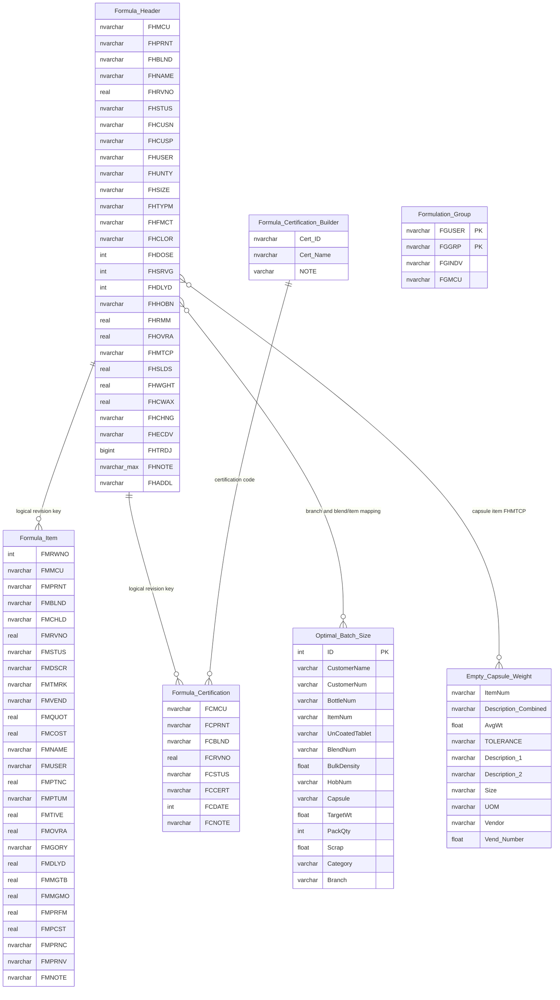
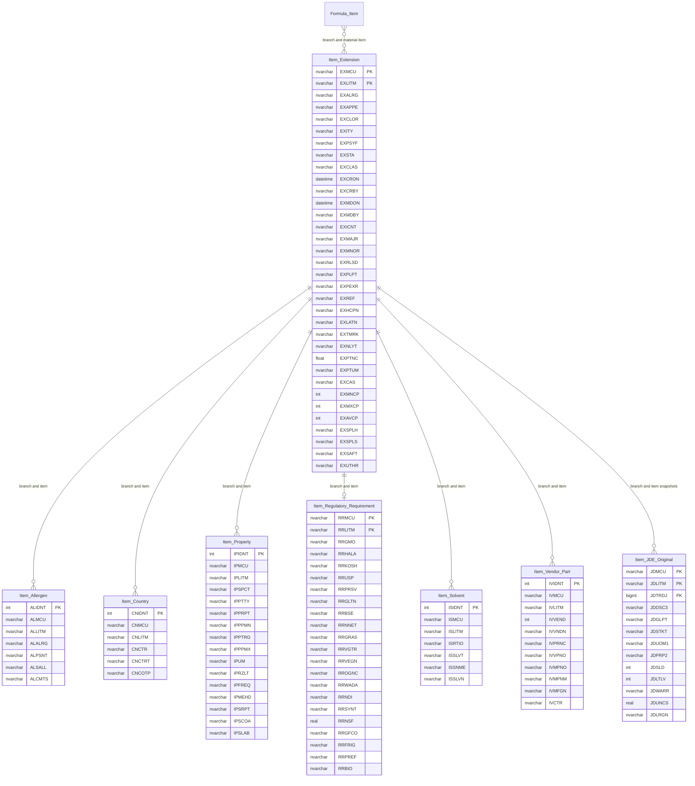
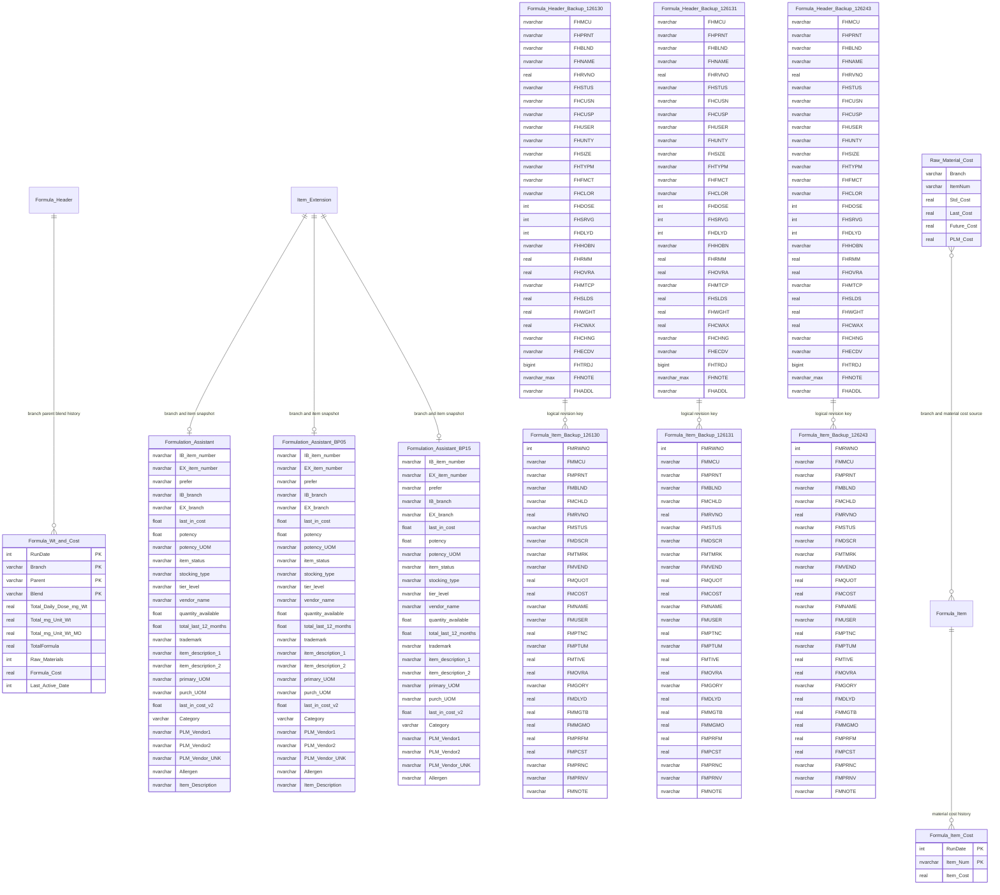
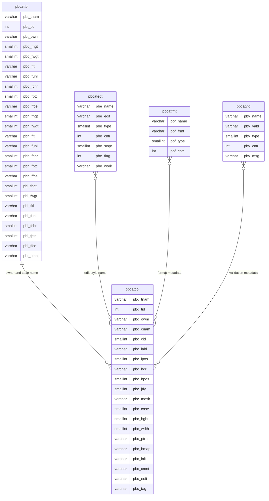
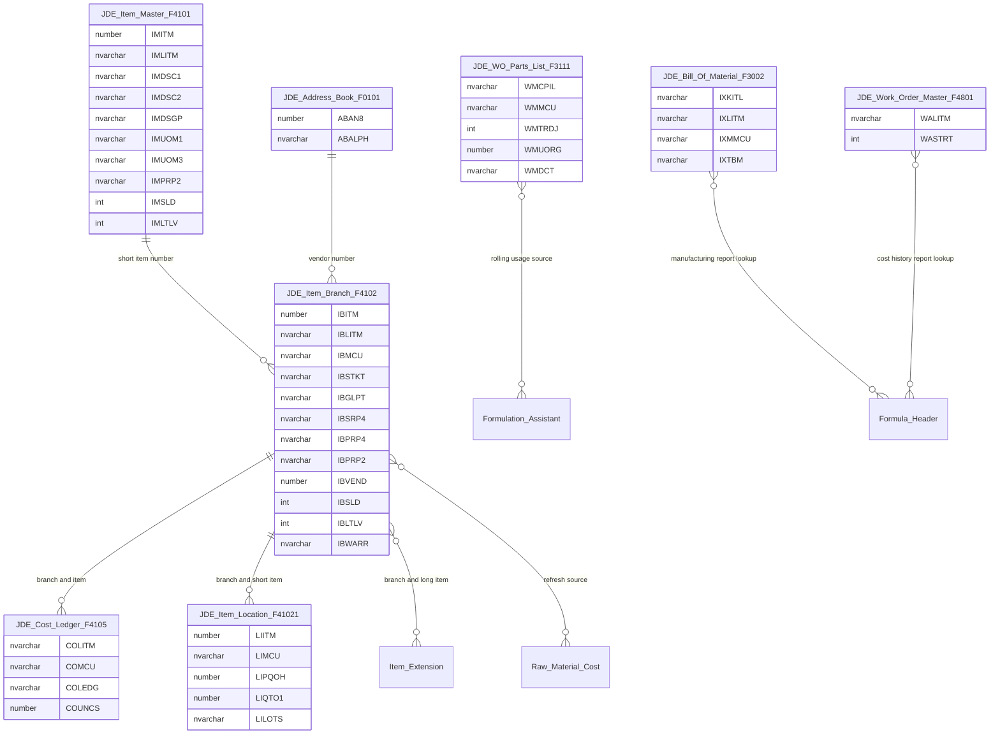

# Current PLM application ERD

This ERD is reconstructed from the current 32-table PLM DDL, 44 stored procedures,
six SQL Agent jobs, and the supplied PowerBuilder main window. It describes the
current structure; it does not add foreign keys or indexes.

Relationship lines are **logical/inferred relationships**, not constraints present
in SQL Server. `PK` marks only primary keys that actually exist in the supplied DDL.
Several tables have no declared key. In particular, the application repeatedly joins
formula headers, lines, and certifications on `(branch, parent, blend, revision,
status)`, but uniqueness is not enforced.

The diagrams are split by concern so Mermaid can render them legibly. Together they
cover all 32 PLM tables. External JDE objects are shown separately because their DDL
was not supplied.

## 1. Formula, certification, administration, and operating reference data

## 2. Material specifications

`Item_Extension` is the branch/item root used by the application. The one-to-many
tables use identity primary keys, while regulatory requirements use the branch/item
pair as their actual primary key. The other relationship columns are not declared as
foreign keys.

## 3. Job-owned caches, history, and backups

These tables are populated by daily procedures/jobs or are dated backup copies. They
are not proposed as CRUD resources. `Proc_Formulation_Assistant_BP35` currently writes
to `Formulation_Assistant_BP15`; the diagram records the physical tables, not an
invented BP35 table.

## 4. PowerBuilder catalog metadata

These five tables belong to PowerBuilder's database catalog, not the PLM domain.

## 5. External ERP dependencies

Only columns referenced by PLM procedures are shown. This is a dependency map, not a
complete JDE physical model.

## Structural cautions before CRUD implementation

- `Formula_Header`, `Formula_Item`, `Formula_Certification`, `Raw_Material_Cost`,
  `Empty_Capsule_Weight`, and all assistant/cache tables have no primary key.
- Revision and formulation numeric values use `real`/`float`; equality and money/math
  behavior should not be carried into a clean target model without profiling.
- Status participates in legacy joins even though it is mutable workflow state.
- The dated backup tables and `pbcat*` catalog tables should not become API resources.
- The six scheduled jobs own the cost/catalog/history tables. CRUD services should not
  write those tables directly.
- Names such as `EXICNT`, `EXPLPT`, `EXPEXR`, `EXHCPN`, and `EXNLYT` could not be
  resolved from the supplied procedures/main window and remain explicitly marked as
  legacy fields in the base view until the missing DataWindow definitions are exported.
