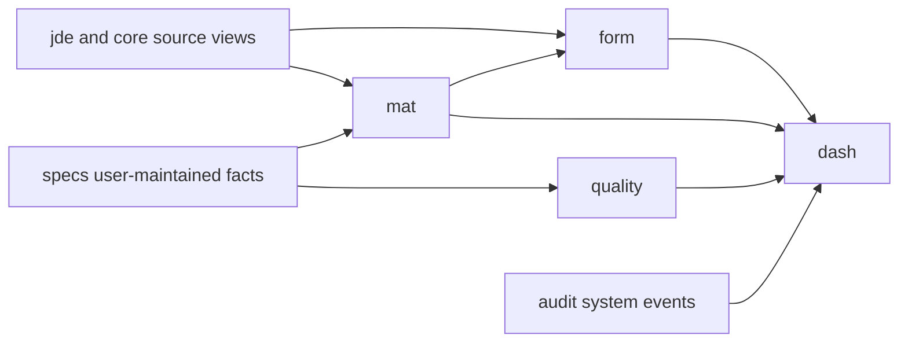

# PLM feature-schema view plan

This is the current target organization for PLM application views:

- `form` — formula authoring, revision detail, calculation inputs and manufacturing context
- `mat` — material catalog, branch facts, cost, inventory and usage
- `specs` — user-maintained material specification records
- `quality` — certification, compliance review and quality work queues
- `audit` — immutable application activity, calculation history and source-refresh history
- `dash` — dashboard-only aggregates composed from the other feature schemas

The `jde` and `core` base/source schemas remain unchanged.

Formula-related JDE completion now takes priority. Its readiness matrix and ordered
work are documented in [`formula_jde_readiness.md`](formula_jde_readiness.md).

## Design rule

Organize a view under the feature that owns its meaning, not every feature that happens
to display it. Other features may consume it.

For example, inventory is owned by `mat`; `dash` may aggregate it and `form` may show
it in a material picker, but neither gets a duplicate inventory view.

## Supplied views and their new ownership

The implementation is in `sql/006_plm_feature_schema_views.sql`.

| Supplied name | Feature-schema name | Grain | Primary purposes |
|---|---|---|---|
| `plm.vw_inventory_balance` | `mat.vw_inventory_balance` | Branch + short item | Material availability, formula material picker, obsolete review, dashboard |
| `plm.vw_item_branch_cost` | `mat.vw_item_branch_cost` | Branch + item | Material search/detail, formula cost input, purchasing/cost reports |
| `plm.vw_material_usage_12_month` | `mat.vw_material_usage_12_month` | Branch + long item | Material demand context, obsolete review, dashboard |
| `plm.vw_latest_work_order_start` | `form.vw_latest_work_order_start` | Branch + item | Formula cost comparison and production context |
| `plm.vw_manufacturing_bom_component` | `form.vw_manufacturing_bom_component` | BOM component/effectivity row | Formula comparison, MMR and production-reference lookup |

No existing `plm` object is dropped by the script. Move consumers to the feature
names, perform row/column parity checks, and retire the old names separately if wanted.

## Source ownership legend

| Classification | Meaning |
|---|---|
| JDE | Authoritative ERP fact; PLM reads but does not edit it |
| User | Entered and maintained by an authorized PLM user |
| Application | Generated or controlled by PLM business logic |
| Admin | Maintained as controlled reference/security data |
| Derived | Calculated from other authoritative values; not directly edited |

## `form` slice

### Views

| View | Shape/use | Source |
|---|---|---|
| `form.vw_formula_header` | One formula revision header; formula register and header editor | Existing `Formula_Header`; mostly user/application |
| `form.vw_formula_line` | One ingredient line; line editing | Existing `Formula_Item`; user selections plus application calculations/snapshots |
| `form.vw_formula_revision_detail` | Header joined to zero or more ordered lines | `form.vw_formula_header` + `form.vw_formula_line` |
| `form.vw_formula_revision_summary` | Line count and stored/calculated revision totals | Formula detail/line views |
| `form.vw_formula_material_context` | Formula line plus current material identity/status/cost; comparison only | Formula line + `mat.vw_material_catalog` |
| `form.vw_latest_work_order_start` | Latest production start for a branch/item | JDE F4801 |
| `form.vw_manufacturing_bom_component` | Manufacturing BOM projection with effectivity | JDE F3002 |

### Where each is used

| UI/use case | Read view | Write target/command |
|---|---|---|
| Formula register/search | `form.vw_formula_header` | None |
| Formula revision detail | `form.vw_formula_revision_detail` | None |
| Create or edit development revision | Header/line views for current values | Formula lifecycle service writing through the corresponding base view/table |
| Add or replace material | `mat.vw_material_catalog` picker | Formula-line command; copy approved snapshots to the line |
| Recalculate formula | Header, lines and `mat.vw_item_branch_cost` | Versioned calculation service updates controlled calculated fields |
| Compare formula with JDE BOM | `form.vw_formula_revision_detail` + `form.vw_manufacturing_bom_component` | None |
| Cost comparison/history | Formula summary + current cost + work-order context | Persisted calculation/cost history, not the live view alone |

### Who supplies the values

- User-filled: name, customer selection, unit type, size, notes, ingredient choice,
  active amount, potency overrides, overage and print choices.
- JDE-selected: parent/blend/material/capsule item identities and customer number/name.
- Application-controlled: revision sequence, workflow state, entered/changed identity,
  timestamps, dosage, mg/unit, percentages, total weight and total cost.
- Snapshot at save/calculation time: material description, trademark, vendor and cost
  when historical reproducibility is required.

## `mat` slice

### Views

| View | Shape/use | Source |
|---|---|---|
| `mat.vw_item_branch_cost` | Identity, branch attributes, JDE vendor and separate cost methods | JDE F4101/F4102/F4105/F0101 |
| `mat.vw_inventory_balance` | Allowed inventory summed by branch/item | JDE F41021 |
| `mat.vw_material_usage_12_month` | Rolling 365-day consumption | JDE F3111 |
| `mat.vw_material_catalog` | One material-search row per branch/item | The three views above plus selected `specs` projections |
| `mat.vw_material_detail` | Catalog facts plus all typed specification collections | Catalog header plus `specs` views; normally composed by the API because of one-to-many children |
| `mat.vw_obsolete_material_candidate` | Formula usage + material status + on-hand + rolling usage | Formula lines + material catalog/inventory/usage |

### Recommended catalog shape

`mat.vw_material_catalog` should contain only fields needed to search, filter and select:

- JDE identity and description;
- branch, UOM, stocking type, categories and status;
- vendor identity/name;
- separate cost methods and an explicitly named approved/legacy selected cost;
- inventory and rolling usage;
- PLM status, potency, potency unit and trademark;
- preference and simple allergen-presence indicators; and
- data-quality flags such as duplicate cost rows.

Do not flatten every allergen, country, property, solvent or vendor part into the
catalog. Those are one-to-many detail collections and would duplicate catalog rows.

### Who supplies the values

- JDE: item identity, descriptions, UOMs, branch settings, vendor, cost, inventory,
  usage, shelf life and lead time.
- Users through `specs`: PLM status, potency, trademark, CAS, handling information,
  regulatory preference, allergen facts and approved vendor-part metadata.
- Application/finance policy: any selected cost or normalized cost. Users do not
  manually overwrite live JDE cost or inventory.

The PLM Materials screen should select an existing JDE material and maintain its PLM
attributes. It should not create a new ERP item or ask users to type current cost or
quantity available.

## `specs` slice

### JDE reference views available now

Implemented in `sql/007_jde_specs_quality_dash_views.sql`:

| View | Purpose | Limitation |
|---|---|---|
| `specs.vw_jde_item_reference` | Item/branch identity and defaults while editing a PLM specification | Reference only; it is not a specification record |
| `specs.vw_jde_address_reference` | Vendor/address search and validation | F0101 is not guaranteed to contain vendors only |
| `specs.vw_jde_code_reference` | JDE UDC descriptions for dropdowns/display | Current base view exposes combined description only |

JDE cannot provide the user-authored specification values listed below. Those still
need PLM-owned persistence.

### Typed CRUD views

| View | User-maintained purpose | Identity supplied by |
|---|---|---|
| `specs.vw_item_extension` | General PLM attributes, potency, CAS, appearance, handling/storage/safety | Branch/item selected from `mat.vw_material_catalog`; audit fields by application |
| `specs.vw_item_allergen` | Allergen presence, source and comments | Branch/item from material catalog; row ID generated |
| `specs.vw_item_country` | Country, detail and classification | Branch/item from material catalog; row ID generated |
| `specs.vw_item_property` | Test/spec property, limits, UOM, method and report text | Branch/item from material catalog; row ID generated |
| `specs.vw_item_regulatory_requirement` | Regulatory statuses and preference | Branch/item from material catalog |
| `specs.vw_item_solvent` | Solvent ratio/type/name/number | Branch/item from material catalog; row ID generated |
| `specs.vw_item_vendor_part` | Approved vendor priority and manufacturer-part details | Branch/item from material catalog; vendor validated against JDE F0101 |

These should remain separate typed contracts even if the UI presents a unified
specification workspace. The current prototype's generic name/value specification
record cannot preserve all of the legacy fields and validation rules.

Suggested read-only shape:

- `specs.vw_material_spec_completion` — one row per branch/item with counts or flags
  indicating which specification areas exist. This supports quality queues and
  dashboards without flattening the detailed records.

## `quality` slice

### JDE operational views available now

Implemented in `sql/007_jde_specs_quality_dash_views.sql`:

| View | Purpose |
|---|---|
| `quality.vw_lot_inventory` | Lot-level on-hand inquiry |
| `quality.vw_lot_hold_detail` | Core-only hold investigation with vendor, customer, work-order and value context |
| `quality.vw_lot_transaction_trace` | Lot transaction genealogy |
| `quality.vw_lot_work_order_reference` | Lot-to-work-order traceability |

These cover operational JDE quality facts, not PLM review decisions or compliance
content. `rpt.vw_lot_hold_summary_prod` and
`rpt.vw_lot_no_expiration_exception_prod` are deliberately excluded until the `rpt`
logic is independently verified.

### PLM quality views still required

| View | Shape/use | Source |
|---|---|---|
| `quality.vw_formula_certification` | Formula certification assignment CRUD | Existing `Formula_Certification`; user-filled |
| `quality.vw_certification_type` | Allowed certification codes | Admin-maintained reference data |
| `quality.vw_formula_certification_detail` | Certification assignment with formula and type descriptions | Quality certification + form header + type |
| `quality.vw_material_compliance_summary` | One row per branch/item with allergen/regulatory/spec-completion flags | `specs` views; derived |
| `quality.vw_review_queue` | Items/formulas awaiting review | Requires a new quality workflow source |

Specification facts belong to `specs`; their review, certification and compliance
interpretation belong to `quality`.

User-filled values include certification assignment/date/notes and specification
review decisions. Reviewer identity, decision timestamps and allowed transitions must
be application-controlled. A review queue cannot be derived reliably until review
status/assignment data is persisted.

## `audit` slice

The current legacy schema does not provide a complete application audit trail. Do not
manufacture one from `modified_by` columns alone.

| Future view | Purpose | Required source |
|---|---|---|
| `audit.vw_change_event` | Who changed which aggregate, when, why and through which action | New append-only application audit-event table |
| `audit.vw_formula_calculation_history` | Calculation version, input hash, totals and validation result | New persisted calculation-run table |
| `audit.vw_source_refresh_history` | JDE/source refresh start, finish, status and row counts | ETL/replication job telemetry |
| `audit.vw_cost_snapshot_history` | Reproducible cost used by an activated formula/report | New snapshot table or governed legacy history migration |

Audit facts are system-generated. Users may supply a reason/comment for sensitive
actions, but must not create, edit or delete audit events.

## `dash` slice

Dashboard views are final aggregates. They should depend on feature views and contain
no independent business ownership or CRUD.

| View | Purpose | Inputs |
|---|---|---|
| `dash.vw_formula_status_count` | Formula counts by workflow status/branch | `form.vw_formula_header` |
| `dash.vw_recent_formula_activity` | Recently changed revisions | Formula audit timestamps/events |
| `dash.vw_material_status_count` | Material counts by branch/status/category | `mat.vw_material_catalog` |
| `dash.vw_material_attention` | Missing cost, duplicate costs, no stock/usage or missing specs | `mat` + `specs.vw_material_spec_completion`; thresholds supplied by policy |
| `dash.vw_quality_work_count` | Pending review/certification counts | `quality.vw_review_queue` |
| `dash.vw_source_health` | Source freshness/failure summary | `audit.vw_source_refresh_history` |

The following JDE-backed dashboard views are implemented now:

- `dash.vw_material_summary`
- `dash.vw_work_order_status_count`

Formula workflow, quality review and source-health dashboard views remain blocked on
PLM-owned formula/review/audit sources; they cannot be created truthfully from JDE.

Avoid hard-coding a quantity such as `quantity_on_hand < 100` into a shared view unless
the business confirms one threshold applies to every material/UOM. Prefer a policy or
material-specific reorder/attention threshold.

## Missing-column notes retained in the feature views

The supplied feature views contain comments, but no placeholder output columns, for:

| Feature view | Not added | Correct source | Add only if |
|---|---|---|---|
| `mat.vw_item_branch_cost` | `tier_level` | F4102 `IBSRP4` | Tier display/filtering is confirmed |
| `mat.vw_item_branch_cost` | `branch_tier_code` | F4102 `IBWARR` | Its distinct business meaning is confirmed |
| `mat.vw_item_branch_cost` | `description_1`, `description_2` | F4101 `IMDSC1`, `IMDSC2` | Exact legacy two-line formatting is required |
| `mat.vw_inventory_balance` | `qty_in_inspection` | F41021 `LIQTO1` | A screen/report actually uses inspection quantity |

## Recommended implementation order

1. Deploy the six feature schemas and the five reorganized source views.
2. Deploy the JDE-backed `specs`, `quality` and `dash` views.
3. Create typed `specs` CRUD views and `form` header/line base views.
4. Build `mat.vw_material_catalog`; migrate material search away from
   `Formulation_Assistant`.
5. Build formula detail/summary views; migrate formula reads away from direct table SQL.
6. Add the calculation and lifecycle services before enabling formula writes.
7. Add quality certification/compliance shapes.
8. Add real audit persistence, then expose audit and remaining dashboard views.
9. Add optional source columns only when a confirmed feature consumes them.
