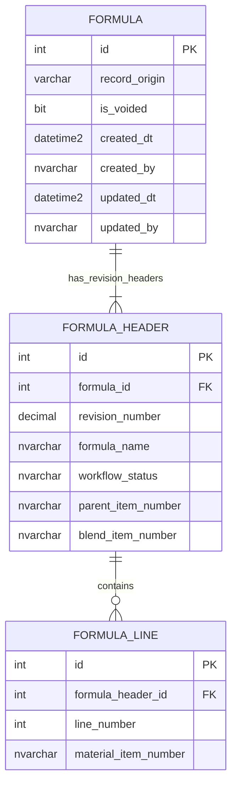

# Formula identity and revision decision

## Confirmed legacy lifecycle

The original PLM creator confirmed:

- `FHPRNT` and `FHBLND` correspond to the future BOM parent/blend relationship.
- In-progress formulas use provisional `P - <name>` and `B - <name>` values.
- The formula undergoes customer iterations, each with a new revision number.
- After customer approval, real parent and blend items are requested from JDE F4101
  and the BOM is created.
- Complete formula history is a primary PLM requirement.

Parent, blend, workflow status, and potentially formula name can therefore change
over the lifetime of one conceptual formula. None is a suitable permanent identity.

## Formula-name stability

The legacy database has no reliable formula-series key, so historical profiling can
only approximate name changes. Using stable branch/parent/blend groups:

| Finding | Result |
|---|---:|
| Parent/blend series with multiple revisions | 5,046 |
| Multi-revision series with more than one normalized formula name | 321 |
| Maximum normalized names for one parent/blend series | 12 |
| Customer/name groups spanning provisional and numeric item values | 575 |

Some may be legacy data errors or reused pairs, but the result is sufficient to reject
formula name as a permanent key. Store the name on each revision so a rename is part
of the historical comparison.

## Approved three-table core

Replace the earlier `header + line + item_map` proposal with:

```text
form.formula
form.formula_header
form.formula_line
```



`form.formula` is deliberately small. It does not use a `formula_code`; its integer
primary key supplies the permanent ID that survives:

- provisional parent/blend becoming numeric JDE items;
- formula-name changes;
- status changes;
- revision creation; and
- replacement or correction of BOM assignments.

`form.formula_header` is the complete revision header. It contains the name,
parent, blend, status, and formulation parameters for that revision.
A strict unique constraint on formula plus revision number
is deferred until the legacy collision profile and import policy are complete.

`form.formula_line` contains the one-to-many ingredient snapshot for that revision.

## Why item map is deferred

The confirmed workflow currently describes one parent and one blend per revision,
which are already preserved on `formula_header`. A mapping table would duplicate those
two fields without adding capability.

Add `form.formula_item_map` later only if the business confirms at least one of these:

- one approved revision can be assigned to multiple parent items;
- one approved revision can be assigned to multiple blend items;
- assignments have their own effective dates independent of formula revisions; or
- additional item roles must be related to the formula without creating another
  revision.

If multiple assignments are confirmed, item map becomes a fourth table; it should not
replace the stable `form.formula` identity.

## Revision creation and difference tracking

Creating a revision should:

1. insert a new `formula_header` for the existing `formula_id`;
2. assign the new revision number and reset approval/workflow state;
3. copy the prior revision's lines;
4. preserve the prior header and lines unchanged; and
5. apply edits only to the new revision.

Compare revisions by `formula_id` and two header IDs:

- compare header scalar values, including name, parent, blend, and status;
- compare lines by stable line number/material identity; and
- classify each value or line as added, removed, or changed.

This satisfies complete saved-revision history. Audit history for intermediate edits
inside one draft remains a separate `audit` responsibility.

## Legacy migration implication

New formulas receive `formula_id` at creation, so future identity is unambiguous.
Legacy data has no equivalent stable key across the provisional-to-JDE transition.

Legacy Development/Quote and Active/Archive histories are grouped independently.
They are not automatically merged. A manually confirmed connection can be recorded
later without making the initial migration depend on exhaustive business review.

Before inserting legacy rows, create a staging crosswalk:

```text
legacy staged header row -> formula_id -> formula_header_id
```

The crosswalk may use customer, normalized name, parent/blend transitions, and revision
sequence as candidate evidence, but ambiguous groups require a business-reviewed
mapping. Do not generate permanent identities solely from formula name, parent, blend,
status, or their concatenation.

## Business confirmation still needed

Ask the original creator:

1. When provisional `P -`/`B -` values are replaced with numeric items, are older
   revision rows updated or do only later revisions receive the numeric values?
2. Is changing `FHNAME` across revisions a supported business action, or are observed
   name differences historical data errors?
3. Can one approved formula revision intentionally create more than one parent/blend
   pair, or must each pair have its own formula/revision record?
4. How did users identify one complete formula history after its provisional parent
   and blend were replaced?
