# Formula ORM ERD

This diagram is the complete implemented three-table formula aggregate. Nullable
columns are determined by the ORM/migration; `PK` and `FK` identify relationships.

```mermaid
erDiagram
    FORMULA ||--o{ FORMULA_HEADER : "has revision headers"
    FORMULA_HEADER ||--o{ FORMULA_LINE : "contains lines"
    FORMULA ||--o{ FORMULA_REVIEW_ISSUE : "requires review"
    FORMULA_HEADER o|--o{ FORMULA_REVIEW_ISSUE : "may identify header"
    FORMULA_LINE o|--o{ FORMULA_REVIEW_ISSUE : "may identify line"

    FORMULA {
        int id PK
        varchar_20 record_origin
        bit is_voided
        bit is_active
        bit is_production
        nvarchar_100 created_by
        datetime2_3 created_dt
        nvarchar_100 updated_by
        datetime2_3 updated_dt
    }

    FORMULA_HEADER {
        int id PK
        int formula_id FK
        int sequence
        decimal_10_4 revision_number
        smallint legacy_duplicate_sequence
        nvarchar_32 workflow_status
        nvarchar_60 formula_name
        nvarchar_12 branch_code
        nvarchar_64 parent_item_number
        nvarchar_64 blend_item_number
        nvarchar_30 customer_number
        nvarchar_60 customer_name
        nvarchar_60 customer_part_number
        nvarchar_30 revision_author
        nvarchar_30 unit_type
        nvarchar_30 size
        nvarchar_30 material_type
        nvarchar_30 category
        nvarchar_30 color
        int dosage_per_unit
        int serving_size
        int daily_dose
        nvarchar_30 hobb_number
        decimal_10_4 raw_material_markup
        decimal_10_4 overage_percent
        nvarchar_30 empty_capsule_number
        decimal_10_4 solids
        decimal_10_4 weight
        decimal_10_4 carnuba_wax
        nvarchar_8 change_type
        nvarchar_32 change_number
        bigint legacy_transaction_julian_date
        nvarchar_max notes
        nvarchar_1024 additional_information
        int calculation_version
        int version
    }

    FORMULA_LINE {
        int id PK
        int formula_header_id FK
        int material_id FK
        int line_number
        nvarchar_25 material_item_number
        nvarchar_12 material_branch_code
        nvarchar_60 material_description
        nvarchar_30 material_category
        nvarchar_64 trademark
        nvarchar_128 selected_vendor_name
        nvarchar_8 primary_uom
        nvarchar_8 cost_uom
        decimal_10_4 quoted_cost
        decimal_10_4 selected_unit_cost
        int cost_run_julian_date
        nvarchar_20 cost_source_code
        decimal_10_4 potency
        nvarchar_8 potency_uom
        decimal_10_4 active_percent
        decimal_10_4 overage_percent
        decimal_10_4 daily_dose_percent
        decimal_10_4 mg_per_capsule_percent
        decimal_10_4 mg_per_capsule_with_overage
        decimal_10_4 formula_percent
        decimal_10_4 cost_percent
        bit is_total_cost_percent
        bit is_total_formula_percent
        nvarchar_30 entered_by
        nvarchar_max notes
    }

    FORMULA_REVIEW_ISSUE {
        int formula_review_issue_id PK
        int formula_id FK
        int formula_header_id FK
        int formula_line_id FK
        nvarchar_50 issue_code
        nvarchar_20 severity
        nvarchar_20 review_status
        nvarchar_1000 issue_detail
        nvarchar_1000 resolution_note
        nvarchar_100 reviewed_by
        datetime2_3 reviewed_dt
        nvarchar_100 created_by
        datetime2_3 created_dt
        nvarchar_100 updated_by
        datetime2_3 updated_dt
    }
```

`FORMULA_LINE.material_id` points to the external material aggregate; that table is
intentionally omitted from this focused formula diagram. Line mutations update the
owning `FORMULA_HEADER.updated_by` and `updated_dt` in the same ORM transaction; the
root `FORMULA` audit timestamp is touched as well.

The legacy `Formula_Wt_and_Cost` result columns are not revision attributes. If the
application later needs reproducible calculation history, they belong in a separate,
versioned formula-calculation snapshot table.
