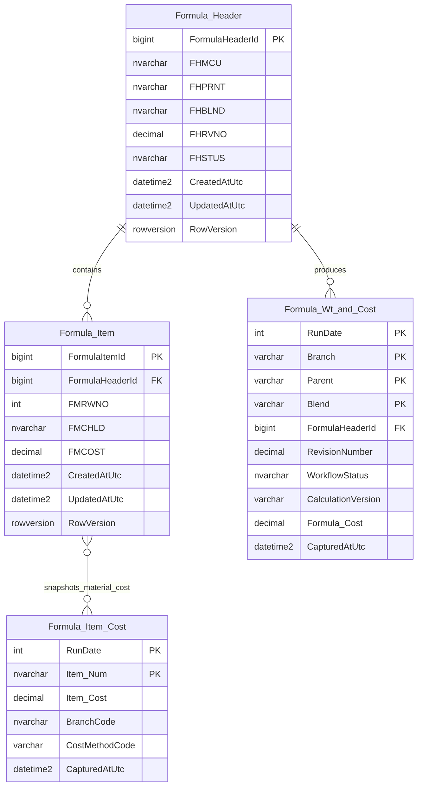

# Formula storage design

## Decision

Treat each `dbo.Formula_Header` row as one authored formula revision and each
`dbo.Formula_Item` row as one ordered ingredient line in that revision.

The application relationship is:



`Formula_Item_Cost` is material-cost history. It does not belong to one formula line:
many formula lines can use the same material snapshot, and the same material can have
many snapshots. `Formula_Wt_and_Cost` is a calculated formula-revision snapshot. It
may point to the header revision that produced it, but it is not the editable source
of that revision.

## Keys and added columns

The migration in `sql/008_harden_legacy_formula_tables.sql` adds:

| Table | Stable key or relationship | Additional context |
|---|---|---|
| `Formula_Header` | `FormulaHeaderId` primary key | created/updated UTC timestamps and `RowVersion` |
| `Formula_Item` | `FormulaItemId` primary key; `FormulaHeaderId` parent key | created/updated UTC timestamps and `RowVersion` |
| `Formula_Item_Cost` | preserves `(RunDate, Item_Num)` for now | branch, cost method, captured UTC |
| `Formula_Wt_and_Cost` | preserves `(RunDate, Branch, Blend, Parent)` for now; nullable header lineage | revision, workflow status, calculation version, captured UTC |

The formula-revision tuple remains unique:

```text
FHMCU + FHPRNT + FHBLND + FHRVNO
```

`FHSTUS` is mutable workflow state, not identity. A read-only profile of the current
PLM data confirmed that the four-column revision tuple is unique across statuses.
The tuple is useful as an import/natural key, but new application code should join
header to lines with `FormulaHeaderId`. Line number is unique only within its header,
enforced as `FormulaHeaderId + FMRWNO`.

All existing `REAL` fields are converted to `decimal(10,4)` except the three historical
mg totals in `Formula_Wt_and_Cost`, which use `decimal(12,4)`. A read-only current-data
profile found 1,112 rows at up to `1000700`, which cannot fit in `decimal(10,4)` (six
integer digits). `decimal(12,4)` preserves those rows and leaves reasonable headroom.
The migration preflight stops before making changes if any value cannot fit its target.

## History-table limitation

The two history keys should not be changed blindly:

- `Formula_Item_Cost` cannot represent separate branch/cost-method values for the same
  run date and item under its current primary key.
- `Formula_Wt_and_Cost` cannot represent multiple revisions or calculation versions
  for the same run date, branch, parent and blend under its current primary key.

The migration therefore adds the missing context as nullable columns without guessing
old values. Update the two population procedures to write those fields, backfill what
can be proven, and only then replace the history keys with a surrogate snapshot key or
a wider business key. The history tables should remain append-only/read-only from the
formula CRUD API.

## SQLAlchemy and Pydantic placement

The normalized SQLAlchemy aggregate uses these SQL Server tables:

```text
[form].[formula]
[form].[formula_header]
[form].[formula_line]
```

The formula-to-revision and revision-to-line foreign keys are schema-qualified. The
optional line-to-material relationship still targets the separately owned material
table; moving material storage belongs to the material slice, not this change.

If the API is changed to perform CRUD against these legacy-named tables, put the ORM
mapping in `backend/plm_api/modules/formulas/models.py`, request/response contracts in
`schemas.py`, persistence operations in `repository.py`, and HTTP endpoints in
`router.py`.

The essential SQLAlchemy relationship is:

```python
class FormulaHeader(Base):
    __tablename__ = "Formula_Header"
    __table_args__ = {"schema": "dbo"}

    id: Mapped[int] = mapped_column("FormulaHeaderId", BigInteger, primary_key=True)
    revision_number: Mapped[Decimal] = mapped_column("FHRVNO", Numeric(10, 4))
    items: Mapped[list[FormulaItem]] = relationship(
        back_populates="header",
        cascade="all, delete-orphan",
        order_by="FormulaItem.line_number",
    )


class FormulaItem(Base):
    __tablename__ = "Formula_Item"
    __table_args__ = {"schema": "dbo"}

    id: Mapped[int] = mapped_column("FormulaItemId", BigInteger, primary_key=True)
    formula_header_id: Mapped[int] = mapped_column(
        "FormulaHeaderId",
        ForeignKey("dbo.Formula_Header.FormulaHeaderId", ondelete="CASCADE"),
    )
    line_number: Mapped[int] = mapped_column("FMRWNO")
    header: Mapped[FormulaHeader] = relationship(back_populates="items")
```

Pydantic does not create the relationship. It validates and serializes the object
shape returned by SQLAlchemy. A nested read model is sufficient:

```python
class FormulaItemRead(ReadModel):
    id: int
    line_number: int


class FormulaHeaderRead(ReadModel):
    id: int
    revision_number: Decimal
    items: list[FormulaItemRead] = Field(default_factory=list)
```

Load the collection explicitly in repository queries with
`selectinload(FormulaHeader.items)`. The database key protects data integrity;
SQLAlchemy provides navigation and unit-of-work behavior; Pydantic provides the API
contract. They complement one another rather than replacing the database relationship.

The repository currently also contains a separate normalized prototype
(`formula`/`formula_header`/`formula_line`) and a legacy read path. Do not map both
write models to the same feature simultaneously. Choose the legacy-table CRUD path or
the normalized path before enabling create/update/delete endpoints.
