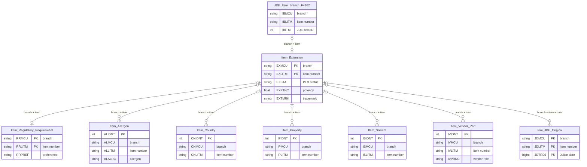
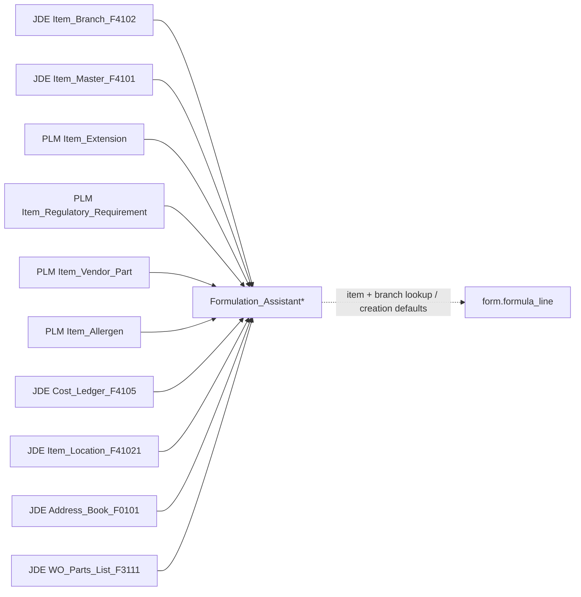

# Legacy item and formulation-assistant relationships

The paste-ready dbdiagram.io version is in `material_assistant_relationships.dbml`.
The proposed `mat` + `spec` target, with a complete legacy column crosswalk,
is in `proposed_material_item_spec_erd.md`.

Reconstructed on 2026-10-28 from read-only `PLM` metadata and aggregate queries,
the `PLM_DEV` schema and formula-line snapshot, production assistant procedure
definitions, and the SQL Agent job scripts supplied by the project owner. The
production tables can change while this document is being read. The production
aggregate queries used read-uncommitted isolation; counts are diagnostic, not a
reconciliation baseline.

## Logical ERD

Only the `PK` labels are declared database constraints in the legacy cluster.
The relationships below use the shared, trimmed `(branch, item_number)` values;
**none is enforced by a foreign key in `PLM`**. The item extension is optional:
child records and JDE items can exist without an extension row.

`Item_JDE_Original` is dated JDE history. It is not an assistant input. The
one-to-many tables have their own identity keys; regulatory requirements and
item extension have one declared row per exact branch/item key.

## Assistant lineage

`Formulation_Assistant` is a rebuilt **material lookup projection**, not a child
table of `Formula_Item` or `form.formula_line`. The procedure starts from JDE
`Item_Branch_F4102` and `Item_Master_F4101`; therefore an assistant row can exist
without an `Item_Extension` row. The assistant tables have no declared primary key.

| Assistant fields | Actual source in `Proc_Formulation_Assistant` |
|---|---|
| `IB_item_number`, `IB_branch`, stocking type, tier | JDE item branch |
| Descriptions, UOMs, category | JDE item master |
| Selected cost and normalized cost | JDE cost ledger: ledger `21` before `07` before `05`, with UOM conversion |
| Quantity available | JDE item location |
| Last 12 months of usage | JDE work-order parts list |
| JDE vendor name | JDE address book |
| `EX_item_number`, potency, potency UOM, PLM status, trademark | `Item_Extension` |
| `prefer` | `Item_Regulatory_Requirement.RRPREF` only |
| Three PLM vendor slots | `Item_Vendor_Part` classified by `IVPRNC` |
| `Allergen` flag | Presence of qualifying `Item_Allergen` rows |

`Item_Country`, `Item_Property`, `Item_Solvent`, and `Item_JDE_Original` do not
feed any of the four production assistant rebuild procedures. The full
regulatory record and allergen detail also remain outside the flattened table.

The owner-supplied job scripts schedule `Proc_Formulation_Assistant` at 00:05
and `Proc_Formulation_Assistant_BP05` at 00:06 daily. They show no job loading an
`Item_*` table. BP15 and BP35 procedures exist but are absent from those jobs.
The BP35 procedure deletes and inserts `Formulation_Assistant_BP15`, a likely
copy/paste defect. The jobs also update formula costs and rebuild separate
formula-cost and raw-material-cost caches; those are downstream calculations,
not item-specification loaders.

## Observed grain and coverage

| Production table | Rows | Distinct branch/item keys | Keys without `Item_Extension` |
|---|---:|---:|---:|
| `Item_Extension` | ~12,251 | unique by declared PK | — |
| `Item_Regulatory_Requirement` | 12,276 | 12,274 after trimming | 210 |
| `Item_Allergen` | 78,671 | 8,309 | 237 |
| `Item_Country` | 14,238 | 11,944 | 32 |
| `Item_Property` | 93,286 | 6,368 | 8 |
| `Item_Solvent` | 13,560 | 9,076 | 10 |
| `Item_Vendor_Part` | 9,615 | 8,192 | 213 |
| `Item_JDE_Original` | 3,380 | 3,130 | 230 |

The assistant branch-10 table has 19,875 rows for 19,106 distinct branch/item
keys; 502 keys have multiple rows, with a maximum of 12. BP05 has 20,634 rows
and 20,634 keys; BP15 has 1,790 rows and 1,790 keys. A direct assistant join
can multiply formula lines, especially for branch 10. Use branch plus item and
choose a deterministic row before applying creation defaults.

The existing `PLM_DEV.form.formula_line` seed has 605,170 rows and 7,961
distinct material branch/item keys, all in branch 10. Of those keys, 6,035
appear in the `PLM_DEV` assistant snapshot, covering 545,094 line rows. A
read-only comparison found 6,809 of the keys in the current production
`Item_Extension`. This comparison mixes an old line snapshot with current
production item data and should be used only to assess coverage. Every current
`formula_line.material_id` is null: the normalized material relationship has
not yet been populated.

## Interpretation for the replacement model

- The PLM `Item_*` tables are likely application-maintained specifications and
  vendor data. The inspected production procedures read four of them, and the
  supplied jobs do not load them. This does **not** prove every row was typed by
  a user; direct application writes and other external processes require a
  separate code or audit review.
- `Item_JDE_Original` has a branch/item/date PK and stores historical JDE
  values. Its capture path is not established by these procedures or jobs.
- `PLM_DEV.dbo.material`, `material_branch`, and `material_specification` are
  new ORM-owned tables, absent from production `PLM` and currently empty. They
  are not the source of the production assistant projection.
- The overlap is intentional for a lookup: the assistant copies selected JDE,
  extension, regulatory, vendor, and allergen values. It does not replace the
  detailed `Item_*` records. In a new design, keep one canonical item/branch
  identity, retain typed child records for allergens, countries, properties,
  solvents, vendors, and regulatory flags, and build the assistant equivalent
  as a refreshable read model. Treat `formula_line` values as the selected
  values for a particular formula revision.

