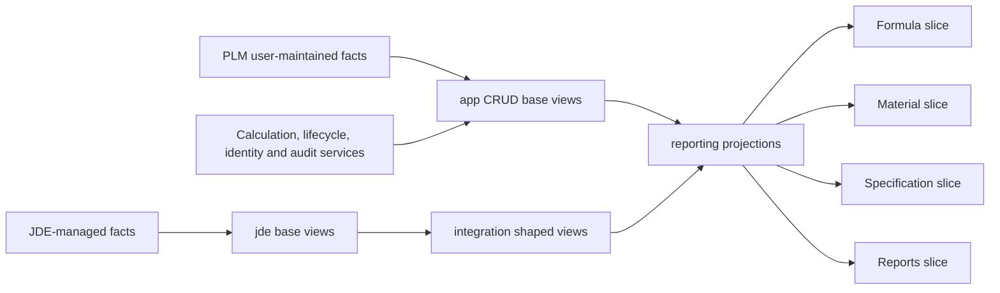

# PLM vertical-slice view and data-ownership map

> Schema naming update: the current feature-schema organization is documented in
> [`feature_schema_view_plan.md`](feature_schema_view_plan.md). The `app`,
> `integration`, and `reporting` names below describe the earlier transitional layer
> and remain useful for source/procedure traceability.

This document groups the PLM views by application feature and identifies:

- which view each screen or use case should consume;
- which views are safe write-facing contracts;
- which facts come from JDE;
- which facts must be entered or maintained by users;
- which values must be calculated or controlled by the application; and
- which source gaps remain.

## View-layer rules

| Schema | Role | Write through it? | Data owner |
|---|---|---:|---|
| `jde` | One-table ERP source contracts from `base_for_plm.sql` | No | JDE |
| `core`, `rpt` | Composed operational JDE views from `base_for_plm.sql` | No | JDE |
| `app` | One-table PLM contracts with readable column names | Yes, through validated application use cases | PLM users/application |
| `integration` | Cross-source or aggregated application read models | No | Derived |
| `reporting` | Screen/report projections | No | Derived |

`app` does not mean every column is freely editable. Identity, audit, calculated,
workflow, and snapshot fields still require application-controlled commands.

## Current application wiring versus target wiring

| Screen/API | Current implementation | Target view boundary |
|---|---|---|
| Overview/dashboard | Direct legacy `Formula_Header` and `Formulation_Assistant`, or normalized prototype tables | Formula base/reporting views plus `reporting.vw_plm_material_catalog` |
| Formulas | Direct legacy `Formula_Header`, or normalized prototype tables | `app.vw_formula_header`, `app.vw_formula_line`, and formula reporting views |
| Materials | Direct legacy `Formulation_Assistant`, or normalized prototype tables | `reporting.vw_plm_material_catalog`; PLM edits through specification `app` views |
| Specifications | Generic normalized `material_specification` table only | Seven typed `app.vw_item_*` views |
| Reports | UI placeholder; no report endpoint | Shared formula/material/specification reporting and integration views |
| Administration | Normalized prototype `app_user` table | Identity provider plus role mapping; `app.vw_user_group` only for legacy coexistence |

This is a target map, not a claim that the current API already consumes the new views.

## 1. Overview/dashboard slice

| Use | Preferred view(s) | Source | Remaining source/work |
|---|---|---|---|
| Formula counts by workflow status | `app.vw_formula_header` grouped by `workflow_status` | PLM formula data | API query; no additional view is necessary |
| Recent formulas | `app.vw_formula_header`, or a future latest-revision projection after the formula key is proven | PLM formula data | Define an authoritative formula/revision key before choosing “latest” |
| Material count and low-inventory alerts | `reporting.vw_plm_material_catalog` | JDE item/inventory plus PLM attributes | Business owner must approve the low-inventory threshold; it is not a user-entered material fact |
| JDE health/last synchronization | None currently | Infrastructure/replication monitoring | Must come from connection/ETL telemetry, not a business view and not user input |

Current code status: the legacy dashboard path queries `dbo.Formula_Header` and
`dbo.Formulation_Assistant` directly. It should be moved to the views above.

## 2. Formula authoring and lifecycle slice

### Views and usage

| View | Used for | Mode |
|---|---|---|
| `app.vw_formula_header` | Formula search, create draft, edit header, workflow commands | CRUD base contract |
| `app.vw_formula_line` | Ingredient list, add/replace/reorder lines, line snapshots | CRUD base contract |
| `reporting.vw_formula_revision_line` | Formula detail, worksheet and weigh-sheet datasets | Read only |
| `reporting.vw_formula_revision_summary` | Stored totals, line counts, formula summary | Read only |
| `reporting.vw_plm_material_catalog` | Material selector and current material defaults | Read only |
| `integration.vw_plm_item_branch_cost` | Current cost choices during calculation/recalculation | Read only |

### Field ownership

| Field group | Where it comes from |
|---|---|
| Formula name, category, customer selection, unit type, size, notes and additional information | Entered by formulator/product-development users |
| Parent item, blend item, capsule item and material item numbers | Selected from approved JDE-backed searches; users choose them but should not invent ERP identities |
| Revision and workflow status | Application lifecycle service; users invoke commands such as create revision, submit, activate or archive |
| `entered_by`, change metadata and timestamps | Authenticated identity/audit service |
| Potency, potency unit, active amount, overage, line notes and print flags | User-entered, optionally defaulted from the material/specification views |
| Material description, trademark, vendor and cost stored on a formula line | Snapshot copied when the line is saved; current defaults come from `reporting.vw_plm_material_catalog` |
| Daily dose, mg/unit, mg with overage, formula percent, cost percent and formula totals | Calculation service using fixed-decimal rules; never manually maintained totals |
| Customer name | Join the selected customer number to `jde.vw_f0101_address_book_prod`; the legacy header stores only the number |

### Remaining decisions

- Prove the formula/revision uniqueness key before enabling update or delete.
- Define the revision state machine and who may perform each transition.
- Approve one versioned calculation policy for unit conversions, dosage, overage and cost.
- Decide whether formula line cost is a permanent historical snapshot, a live value,
  or both. Historical reports should not silently change with today's JDE cost.

Current code status: legacy formula search still reads `dbo.Formula_Header` directly.
Normalized-mode writes use `formula`, `formula_header` and
`formula_line` tables rather than the `app` views.

## 3. Materials and sourcing slice

### Views and usage

| View | Used for | Principal source |
|---|---|---|
| `reporting.vw_plm_material_catalog` | Canonical material search/list/detail summary | Composed JDE + PLM |
| `integration.vw_plm_item_branch_cost` | Branch item facts, JDE vendor and separate cost methods | JDE F4101/F4102/F4105/F0101 |
| `integration.vw_plm_inventory_balance` | Branch inventory totals | JDE F41021 |
| `integration.vw_plm_material_usage_12_month` | Rolling material usage | JDE F3111 |
| `app.vw_item_extension` | PLM status, potency, trademark, CAS, descriptive and handling attributes | User-maintained PLM data |
| `app.vw_item_vendor_part` | Approved vendor/manufacturer parts and priorities | Purchasing/sourcing users |
| `app.vw_item_allergen` | Catalog allergen indicator and allergen details | QA/regulatory users |
| `app.vw_item_regulatory_requirement` | Preference and regulatory attributes used by the catalog | QA/regulatory users |

### Field ownership

| Material facts | Owner/source |
|---|---|
| Item number, item description, UOMs, stocking type, item/GL/category codes, shelf life, lead time and JDE vendor number | JDE; read only in PLM |
| Costs 01/05/07/21 | JDE F4105; read only and kept as separate methods |
| On-hand, commitments, purchase orders and work orders | JDE F41021; read only |
| Rolling usage | JDE F3111; derived by the integration view |
| PLM item status, potency, trademark, CAS, Latin name, handling/storage/safety text | User-maintained through `app.vw_item_extension` |
| Approved vendor names, priorities and manufacturer-part details | Purchasing/sourcing through `app.vw_item_vendor_part` |
| Catalog selected/normalized cost | Application/finance policy derived from JDE costs; not a user-entered value |

The Materials screen should not offer “register material” as creation of a JDE item.
The correct PLM operation is to select an existing JDE item and create or edit its
PLM-owned extension/specification records. New ERP item creation belongs in JDE.

Current code status: legacy material search still reads
`dbo.Formulation_Assistant`. Normalized mode permits users to create a separate local
material and enter cost/inventory, which conflicts with the intended JDE ownership and
should be removed when the PLM_DEV view adapter is connected.

## 4. Material specifications slice

All seven legacy specification areas are separate typed contracts. A single screen may
host them, but the API should keep their validation and persistence distinct.

| Feature | CRUD base view | User-maintained content | System/JDE content |
|---|---|---|---|
| Extension/general | `app.vw_item_extension` | Appearance, color, physical form, PLM status/classification, categories, release flag, reference, Latin name, trademark, potency, CAS, capsule values, handling/storage/safety/other text | Branch and item are selected from the JDE material catalog; created/modified identity and timestamps are system-set |
| Allergens | `app.vw_item_allergen` | Allergen, present status, source text, comments | Identity generated; branch/item selected from JDE |
| Countries | `app.vw_item_country` | Country, detail and country type | Identity generated; branch/item selected from JDE |
| Properties/testing | `app.vw_item_property` | Specification/property type, name, min/target/max, UOM, result, frequency, method and report/COA/label text | Identity generated; branch/item selected from JDE |
| Regulatory | `app.vw_item_regulatory_requirement` | GMO, halal, kosher, USP, preservative, gluten, BSE, non-novel, GRAS, vegetarian, vegan, organic, WADA, NDI, synthetic, NSF, GFCO, fragrance, preference and bioengineered values | Branch/item selected from JDE |
| Solvents | `app.vw_item_solvent` | Ratio, type, name and number | Identity generated; branch/item selected from JDE |
| Vendor parts | `app.vw_item_vendor_part` | Vendor selection/priority, vendor part, manufacturer part/name, manufacturer and country | Vendor number/name should preferably be selected/validated against `jde.vw_f0101_address_book_prod`; identity generated |

Most specification content is user-filled by R&D, QA, regulatory or purchasing. It
does not come from JDE unless a separate mastered interface is later identified.
Supporting-document storage, approval/review status, reviewer identity and effective
dates are not represented by the current legacy views and require a new PLM-owned
document/workflow design if needed.

Current code status: the prototype stores every kind in one generic
`material_specification` table. That is useful as a demo but does not preserve the
typed legacy fields above.

## 5. Certifications slice

| View | Used for | Data source |
|---|---|---|
| `app.vw_formula_certification` | Add/remove a certification from a formula revision; enter date/notes | User-maintained formula data |
| `app.vw_certification_type` | Administer allowed certification codes and descriptions | Admin/QA maintained reference data |
| `reporting.vw_formula_certification` | Certification reports and formula detail display | Composed formula + certification data |

The certification assignment is user-filled. Certification code must come from the
administered type list. Formula identity comes from the selected formula revision;
formula users should not retype the five-part legacy key.

## 6. Manufacturing, BOM and production-reference slice

| View | Used for | Source |
|---|---|---|
| `integration.vw_plm_manufacturing_bom_component` | Manufacturing BOM lookup, component/effectivity display and MMR support | JDE F3002 |
| `integration.vw_plm_latest_work_order_start` | Last/latest work-order start reference and cost-comparison support | JDE F4801 |
| `integration.vw_plm_material_usage_12_month` | Historical material use | JDE F3111 |
| `jde.vw_f3112_wo_routing_prod` | Routing/operation details when a production routing screen or report is added | JDE |
| `jde.vw_f4802_wo_remarks_prod` | Work-order remarks when required by MMR/worksheet output | JDE |
| `core.vw_bom_lines_active_prod` | Effective/current BOM lines | Derived from JDE |
| `core.vw_bom_lines_short_prod` | Condensed BOM lookup | Derived from JDE |

These are ERP facts and are read-only in PLM. Formula users may select a BOM or work
order reference, but changes to the official manufacturing BOM, routing, work order or
remarks must occur in JDE. The exact business date for BOM effectivity must be supplied
by the use case; the shaped view intentionally does not assume today's date.

## 7. Inventory, lot and quality-status slice

| View | Used for | Source/current status |
|---|---|---|
| `integration.vw_plm_inventory_balance` | Material availability summary | JDE; used by material catalog |
| `jde.vw_f4108_lot_master_prod` | Lot master facts | JDE; available but not yet wired to a PLM screen |
| `jde.vw_F4111_item_ledger_prod` | Item/lot transaction history | JDE; available but not yet wired |
| `core.vw_lot_inventory_onhand_prod` | On-hand lot detail | JDE-derived; available but not yet wired |
| `core.vw_lot_item_byholds_prod` | Held-lot material detail | JDE-derived; available but not yet wired |
| `core.vw_lot_transaction_use_prod` | Lot usage trace | JDE-derived; available but not yet wired |
| `core.vw_lot_wo_reference_prod` | Lot-to-work-order references | JDE-derived; available but not yet wired |
| `rpt.vw_lot_hold_summary_prod` | Hold summary report | JDE-derived; available but not yet wired |
| `rpt.vw_lot_no_expiration_exception_prod` | Missing-expiration exception report | JDE-derived; available but not yet wired |

Lot status, quantity, expiry and transaction facts must come from JDE. PLM users
should not edit them. If PLM needs a QA disposition, investigation note or acknowledgement,
that is new user-entered PLM data and requires its own table/view; none exists today.

## 8. Batch and capsule reference slice

| View | Used for | Source/ownership |
|---|---|---|
| `app.vw_optimal_batch_size` | Batch-size recommendation inputs and production/formula reporting | Maintained by formulation/process/production-planning users unless an ERP source is identified |
| `app.vw_empty_capsule_weight` | Capsule-weight calculation lookup | Maintained by QA/purchasing/formulation users; vendor should be validated against JDE |

These records are not currently derived from JDE. They are user-maintained reference
data today. Ownership, approval, effective dates and duplicate rules must be confirmed
before enabling updates.

## 9. Reports and document-output slice

| Report family | Primary view(s) | Additional information required |
|---|---|---|
| Formulation/coating worksheets, weigh sheets and sign-off | `reporting.vw_formula_revision_line` | Versioned calculation results; permission-controlled cost/vendor disclosure; report template |
| Formula weight and cost | `reporting.vw_formula_revision_summary` | Historical `Formula_Wt_and_Cost` job data if “as of” reproduction is required |
| Formula cost comparison | Formula views + `integration.vw_plm_item_branch_cost` + `integration.vw_plm_latest_work_order_start` | Approved cost method/precedence and historical cost snapshots |
| Allergens | Formula revision lines + `app.vw_item_allergen` | User-maintained allergen records and report wording/template |
| Regulatory requirements | Formula revision lines + `app.vw_item_regulatory_requirement` + JDE item descriptions | User-maintained regulatory records |
| Certifications | `reporting.vw_formula_certification` | User assignments and admin-maintained certification types |
| Obsolete materials | Formula revision lines + `integration.vw_plm_item_branch_cost` + `integration.vw_plm_inventory_balance` | Business definition of obsolete/inactive |
| MMR/BOM | Formula header + `app.vw_item_extension` + `integration.vw_plm_manufacturing_bom_component` | Report-specific production rules and approved effectivity date |

Report format, signatures, disclosure switches, approval text and confidential-output
permissions do not belong in JDE views. They must come from report templates,
authorization policy and, where applicable, user choices recorded with the output.

Current code status: the Reports page is presentation-only and has no report endpoint.

## 10. Administration and access-control slice

| View | Used for | Source/ownership |
|---|---|---|
| `app.vw_user_group` | Legacy group/individual/branch permissions | Admin-maintained legacy PLM data |

Display name, email, active status and modern capability roles are not in the legacy
view. They must come from managed identity/HR directory plus a PLM role mapping, or
from a new PLM-owned user profile table. The normalized prototype currently uses
`app_user`; it is not backed by `app.vw_user_group`.

## 11. Supporting JDE views not yet assigned to a PLM screen

| View | Likely future slice | Action |
|---|---|---|
| `jde.vw_f0005_meta_data_prod` | Shared JDE code descriptions/dropdowns | Use when a field needs an authoritative code label; do not copy labels into user-entered PLM fields |
| `jde.vw_f4201_so_master_prod` | Sales/customer order context | Keep read only; add only when a formula/customer/order use case is defined |
| `jde.vw_f4211_so_detail_prod` | Sales-order line/SKU context | Keep read only; add only when a report or lookup requires it |

## Canonical versus transitional views

New PLM_DEV application work should use:

- `jde.vw_*_prod` as the JDE base boundary;
- `app.vw_*` as the PLM write-facing boundary;
- `integration.vw_plm_*` for composed operational reads; and
- `reporting.vw_plm_material_catalog` plus the formula reporting views for screens and reports.

The following are transitional and should not be wired into new features:

- `reporting.vw_material_catalog_snapshot` and physical
  `Formulation_Assistant*` tables: legacy job-owned caches;
- `integration.vw_jde_*` views from `001_base_views.sql`: earlier direct-replica
  contracts superseded by the deployed `jde.vw_*_prod` base views;
- `integration.vw_jde_item_branch_cost` and
  `integration.vw_jde_inventory_balance`: superseded by their
  `integration.vw_plm_*` equivalents.

They should remain only while parity testing or legacy coexistence still requires them.

## Complete view-to-slice register

This register places every view from `base_for_plm.sql`, `001_base_views.sql`, and
`004_plm_dev_shaped_views.sql` into a primary vertical slice. Some views are shared by
more than one feature; the primary slice is the team that should own its application
contract.

### Formula and certification ownership

| View | Primary slice | Status/use |
|---|---|---|
| `app.vw_formula_header` | Formula | CRUD base |
| `app.vw_formula_line` | Formula | CRUD base |
| `reporting.vw_formula_revision_line` | Formula | Detail/report read model |
| `reporting.vw_formula_revision_summary` | Formula | Summary/report read model |
| `app.vw_formula_certification` | Certification | CRUD base |
| `app.vw_certification_type` | Certification | Admin CRUD base |
| `reporting.vw_formula_certification` | Certification | Report read model |

### Material and sourcing ownership

| View | Primary slice | Status/use |
|---|---|---|
| `jde.vw_f4101_item_master_prod` | Materials | Canonical JDE base |
| `jde.vw_f4102_item_branch_prod` | Materials | Canonical JDE base |
| `jde.vw_f4105_cost_ledger_prod` | Materials/cost | Canonical JDE base |
| `jde.vw_f0101_address_book_prod` | Shared party/vendor/customer | Canonical JDE base |
| `integration.vw_plm_item_branch_cost` | Materials/cost | Canonical shaped read model |
| `integration.vw_plm_inventory_balance` | Materials/inventory | Canonical shaped read model |
| `integration.vw_plm_material_usage_12_month` | Materials/usage | Canonical shaped read model |
| `reporting.vw_plm_material_catalog` | Materials | Canonical screen/report read model |
| `reporting.vw_material_catalog_snapshot` | Materials | Transitional legacy snapshot union |
| `integration.vw_jde_address_book_f0101` | Shared party/vendor/customer | Transitional direct-replica view |
| `integration.vw_jde_item_master_f4101` | Materials | Transitional direct-replica view |
| `integration.vw_jde_item_branch_f4102` | Materials | Transitional direct-replica view |
| `integration.vw_jde_item_location_f41021` | Materials/inventory | Transitional direct-replica view |
| `integration.vw_jde_cost_ledger_f4105` | Materials/cost | Transitional direct-replica view |
| `integration.vw_jde_work_order_parts_f3111` | Materials/usage | Transitional direct-replica view |
| `integration.vw_jde_item_branch_cost` | Materials/cost | Superseded shaped view |
| `integration.vw_jde_inventory_balance` | Materials/inventory | Superseded shaped view |

### Specification ownership

| View | Primary slice | Status/use |
|---|---|---|
| `app.vw_item_extension` | Material specifications | CRUD base |
| `app.vw_item_allergen` | Allergens/QA | CRUD base |
| `app.vw_item_country` | Country/compliance | CRUD base |
| `app.vw_item_property` | Testing/specifications | CRUD base |
| `app.vw_item_regulatory_requirement` | Regulatory | CRUD base |
| `app.vw_item_solvent` | Solvents/specifications | CRUD base |
| `app.vw_item_vendor_part` | Purchasing/sourcing | CRUD base |

### Manufacturing and production ownership

| View | Primary slice | Status/use |
|---|---|---|
| `jde.vw_f3002_bom_master_prod` | Manufacturing/BOM | Canonical JDE base |
| `jde.vw_f3111_wo_parts_list_prod` | Manufacturing/usage | Canonical JDE base |
| `jde.vw_f3112_wo_routing_prod` | Manufacturing/routing | Available, not yet consumed |
| `jde.vw_f4801_wo_master_prod` | Manufacturing/work orders | Canonical JDE base |
| `jde.vw_f4802_wo_remarks_prod` | Manufacturing/work orders | Available, not yet consumed |
| `core.vw_bom_lines_active_prod` | Manufacturing/BOM | Available composed JDE read |
| `core.vw_bom_lines_short_prod` | Manufacturing/BOM | Available composed JDE read |
| `integration.vw_plm_manufacturing_bom_component` | Manufacturing/BOM | Canonical shaped read model |
| `integration.vw_plm_latest_work_order_start` | Manufacturing/work orders | Canonical shaped read model |
| `integration.vw_jde_bill_of_material_f3002` | Manufacturing/BOM | Transitional direct-replica view |
| `integration.vw_jde_work_order_master_f4801` | Manufacturing/work orders | Transitional direct-replica view |

### Inventory, lot and quality ownership

| View | Primary slice | Status/use |
|---|---|---|
| `jde.vw_f41021_item_loc_prod` | Inventory | Canonical JDE base |
| `jde.vw_f4108_lot_master_prod` | Lot traceability | Available, not yet consumed |
| `jde.vw_F4111_item_ledger_prod` | Lot transactions | Available, not yet consumed |
| `core.vw_lot_inventory_onhand_prod` | Lot inventory | Available composed JDE read |
| `core.vw_lot_item_byholds_prod` | Lot holds | Available composed JDE read |
| `core.vw_lot_transaction_use_prod` | Lot traceability | Available composed JDE read |
| `core.vw_lot_wo_reference_prod` | Lot/work-order traceability | Available composed JDE read |
| `rpt.vw_lot_hold_summary_prod` | Lot reports | Available report view |
| `rpt.vw_lot_no_expiration_exception_prod` | Lot reports | Available report view |

### Batch, reference, sales and administration ownership

| View | Primary slice | Status/use |
|---|---|---|
| `app.vw_optimal_batch_size` | Batch planning | CRUD base; user-maintained |
| `app.vw_empty_capsule_weight` | Capsule reference | CRUD base; user-maintained |
| `app.vw_user_group` | Administration | CRUD base; admin-maintained |
| `jde.vw_f0005_meta_data_prod` | Shared reference data | Available JDE code descriptions |
| `jde.vw_f4201_so_master_prod` | Sales-order context | Available, not yet assigned to a use case |
| `jde.vw_f4211_so_detail_prod` | Sales-order context | Available, not yet assigned to a use case |

## Known source gaps

| Needed fact | Correct source | User-filled? | Status |
|---|---|---:|---|
| Tier level | JDE F4102 `IBSRP4` exposed as `tier_level` | No | Missing from current base-view output |
| Branch tier/warehouse code | JDE F4102 `IBWARR` exposed as `branch_tier_code` | No | Missing; confirm whether distinct from tier level |
| Separate item description lines | JDE F4101 `IMDSC1`, `IMDSC2` | No | Combined description exists; separate outputs missing |
| Quantity in inspection | JDE F41021 `LIQTO1` | No | Optional; missing from output |
| Customer name for formulas | JDE F0101 joined from customer number | No | Join/projection not yet created |
| Formula calculations | Versioned PLM calculation service | No | Not implemented in the view layer by design |
| Cost-selection policy | Finance-approved application policy | No | Current view exposes methods and labels legacy fallback |
| Spec approval/effective dates/documents | New PLM workflow/document entities | Yes/system | Not represented by current legacy schema |
| Modern user profile and capability roles | Identity provider + PLM role mapping | Admin/system | Not represented by `app.vw_user_group` |
| Historical reproducible formula cost | Persisted calculation/cost snapshot | System | Legacy history exists, but no canonical new contract yet |

## Recommended application wiring order

1. Replace formula and dashboard direct-table reads with `app`/`reporting` views.
2. Replace `Formulation_Assistant` reads with `reporting.vw_plm_material_catalog`.
3. Change the Materials UI from “create ERP material” to “select JDE item and maintain
   PLM extension/specifications.”
4. Implement typed specification endpoints over the seven `app` views.
5. Add formula lifecycle and calculation services before allowing formula writes.
6. Add report endpoints over the shared reporting/integration views.
7. Add lot, routing, sales-order or work-order detail only when a concrete vertical
   slice requires those already-available JDE views.
