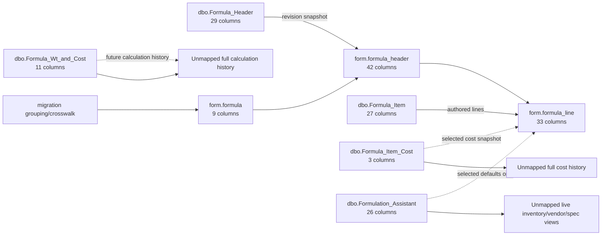

# Legacy formula source to ORM mapping

This is the migration contract from the five approved legacy formula sources into
the proposed three-table model:

The current executable path is listed in [`../sql/README.md`](../sql/README.md).
`027_form_line_seed_procedure.sql` copies source line fields and intentionally
defers material, assistant, and item-cost enrichment. The cost precedence below
is a design rule for that later enrichment, not behavior of the current seed.

```text
form.formula -> form.formula_header -> form.formula_line
```

## Status legend

| Flag | Meaning |
|---|---|
| `MATCH` | Direct source-to-target value, with trimming/type conversion as needed |
| `CONDITIONAL` | Stored only when selected as the revision/line snapshot or creation default |
| `RELATIONSHIP` | Used to locate/correlate a target row, but not stored again |
| `DERIVED` | Generated by migration or calculated from source ordering/lookup |
| **`UNMATCHED`** | Intentionally not stored in the three formula tables |
| **`CONFIRM`** | A likely mapping exists, but business/source semantics must be verified |

## Source flow



## `dbo.Formula_Header` -> `form.formula_header`

| Source column | Source type | Target column | Flag | Migration note |
|---|---|---|---|---|
| `FHMCU` | `nvarchar(12)` | `branch_code` | `MATCH` | Trim surrounding spaces |
| `FHPRNT` | `nvarchar(64)` | `parent_item_number` | `MATCH` | Preserve provisional `P - ...` and numeric values |
| `FHBLND` | `nvarchar(64)` | `blend_item_number` | `MATCH` | Preserve provisional `B - ...` and numeric values |
| `FHNAME` | `nvarchar(60)` | `formula_name` | `MATCH` | Revision-level because the name can change |
| `FHRVNO` | `real` | `revision_number` | `MATCH` | Convert to `decimal(16,8)` |
| `FHSTUS` | `nvarchar(32)` | `workflow_status` | `MATCH` | Status is not identity |
| `FHCUSN` | `nvarchar(30)` | `customer_name` | **`CONFIRM`** | Sample values look like names (`NuSkin`), despite the legacy abbreviation; do not assume customer number |
| `FHCUSP` | `nvarchar(60)` | `customer_part_number` | `MATCH` | Preserve as entered |
| `FHUSER` | `nvarchar(30)` | `revision_author` | `MATCH` | Legacy revision author, distinct from audit `created_by` |
| `FHUNTY` | `nvarchar(30)` | `unit_type` | `MATCH` |  |
| `FHSIZE` | `nvarchar(30)` | `size` | `MATCH` |  |
| `FHTYPM` | `nvarchar(30)` | `material_type` | `MATCH` | Business label still needs confirmation |
| `FHFMCT` | `nvarchar(30)` | `category` | `MATCH` |  |
| `FHCLOR` | `nvarchar(30)` | `color` | `MATCH` |  |
| `FHDOSE` | `int` | `dosage_per_unit` | `MATCH` |  |
| `FHSRVG` | `int` | `serving_size` | `MATCH` |  |
| `FHDLYD` | `int` | `daily_dose` | `MATCH` |  |
| `FHHOBN` | `nvarchar(30)` | `hobb_number` | `MATCH` |  |
| `FHRMM` | `real` | `raw_material_markup` | `MATCH` | Convert to `decimal(16,8)` |
| `FHOVRA` | `real` | `overage_percent` | `MATCH` | Convert to `decimal(16,8)` |
| `FHMTCP` | `nvarchar(30)` | `empty_capsule_number` | `MATCH` | Preserved pending later item-role normalization |
| `FHSLDS` | `real` | `solids` | `MATCH` | Convert to `decimal(16,8)` |
| `FHWGHT` | `real` | `weight` | `MATCH` | Convert to `decimal(16,8)` |
| `FHCWAX` | `real` | `carnuba_wax` | `MATCH` | Convert to `decimal(16,8)` |
| `FHCHNG` | `nvarchar(8)` | `change_type` | `MATCH` |  |
| `FHECDV` | `nvarchar(32)` | `change_number` | `MATCH` |  |
| `FHTRDJ` | `bigint` | `legacy_transaction_julian_date` | `MATCH` | Preserve raw value; do not guess calendar conversion |
| `FHNOTE` | `nvarchar(max)` | `notes` | `MATCH` | Also contains some manual Development-to-Active lineage evidence |
| `FHADDL` | `nvarchar(1024)` | `additional_information` | `MATCH` |  |

`legacy_duplicate_sequence` is migration-generated audit metadata. It is `NULL` when
the normalized legacy revision key is unique. For every member of a duplicate-key
group it contains `1..n`, preserving all source rows without pretending the legacy
five-column key was unique.

## `dbo.Formula_Item` -> `form.formula_line`

| Source column | Source type | Target column | Flag | Migration note |
|---|---|---|---|---|
| `FMRWNO` | `int` | `line_number` | `MATCH` | Legacy row number within a revision |
| `FMMCU` | `nvarchar(12)` | `formula_header_id` lookup | `RELATIONSHIP` | Join/crosswalk component; not repeated on the line |
| `FMPRNT` | `nvarchar(64)` | `formula_header_id` lookup | `RELATIONSHIP` | Join/crosswalk component; header stores parent |
| `FMBLND` | `nvarchar(64)` | `formula_header_id` lookup | `RELATIONSHIP` | Join/crosswalk component; header stores blend |
| `FMCHLD` | `nvarchar(25)` | `material_item_number` | `MATCH` | Also used to resolve nullable `material_id` |
| `FMRVNO` | `real` | `formula_header_id` lookup | `RELATIONSHIP` | Decimal-normalize before matching header revision |
| `FMSTUS` | `nvarchar(30)` | validation only | `RELATIONSHIP` | Validate correlation; do not make status target identity |
| `FMDSCR` | `nvarchar(60)` | `material_description` | `MATCH` | Authored revision snapshot |
| `FMTMRK` | `nvarchar(64)` | `trademark` | `MATCH` |  |
| `FMVEND` | `nvarchar(128)` | `selected_vendor_name` | `MATCH` | Authored vendor takes precedence over cache defaults |
| `FMQUOT` | `real` | `quoted_cost` | `MATCH` | Convert to `decimal(16,8)` |
| `FMCOST` | `real` | `selected_unit_cost` | `MATCH` | Highest migration precedence for the authored line cost |
| `FMNAME` | `nvarchar(60)` | `formula_header.formula_name` validation | `RELATIONSHIP` | Do not duplicate formula name on each line |
| `FMUSER` | `nvarchar(30)` | `entered_by` | `MATCH` | Legacy line author, distinct from audit `created_by` |
| `FMPTNC` | `real` | `potency` | `MATCH` | Convert to `decimal(16,8)` |
| `FMPTUM` | `nvarchar(8)` | `potency_uom` | `MATCH` |  |
| `FMTIVE` | `real` | `active_percent` | `MATCH` | Convert to `decimal(16,8)` |
| `FMOVRA` | `real` | `overage_percent` | `MATCH` | Convert to `decimal(16,8)` |
| `FMGORY` | `nvarchar(30)` | `material_category` | `MATCH` |  |
| `FMDLYD` | `real` | `daily_dose_percent` | `MATCH` | Convert to `decimal(16,8)` |
| `FMMGTB` | `real` | `mg_per_capsule_percent` | `MATCH` | Convert to `decimal(16,8)` |
| `FMMGMO` | `real` | `mg_per_capsule_with_overage` | `MATCH` | Convert to `decimal(16,8)` |
| `FMPRFM` | `real` | `formula_percent` | `MATCH` | Convert to `decimal(16,8)` |
| `FMPCST` | `real` | `cost_percent` | `MATCH` | Convert to `decimal(16,8)` |
| `FMPRNC` | `nvarchar(1)` | `is_total_cost_percent` | `MATCH` | Normalize legacy flag to `bit` |
| `FMPRNV` | `nvarchar(1)` | `is_total_formula_percent` | `MATCH` | Normalize legacy flag to `bit` |
| `FMNOTE` | `nvarchar(256)` | `notes` | `MATCH` |  |

## `dbo.Formula_Item_Cost` -> selected line cost snapshot

| Source column | Source type | Target column | Flag | Migration note |
|---|---|---|---|---|
| `RunDate` | `int` | `cost_run_julian_date` | `CONDITIONAL` | Store only for the selected historical cost row |
| `Item_Num` | `nvarchar(25)` | line lookup by `material_item_number` | `RELATIONSHIP` | Do not store a second item-number copy |
| `Item_Cost` | `real` | `selected_unit_cost` | `CONDITIONAL` | Use only when authored `Formula_Item.FMCOST` is absent |

**UNMATCHED:** the complete item-cost time series does not fit one formula-line
snapshot. Preserve it in the legacy source or a future `mat.material_cost_history`.

## `dbo.Formula_Wt_and_Cost` -> future calculation snapshot/history

| Source column | Source type | Target column | Flag | Migration note |
|---|---|---|---|---|
| `RunDate` | `int` | — | **`UNMATCHED`** | Future calculation-run identity |
| `Branch` | `varchar(12)` | revision lookup by `branch_code` | `RELATIONSHIP` | Do not duplicate calculation identity |
| `Parent` | `varchar(25)` | revision lookup by `parent_item_number` | `RELATIONSHIP` |  |
| `Blend` | `varchar(25)` | revision lookup by `blend_item_number` | `RELATIONSHIP` |  |
| `Total_Daily Dose/mg Wt` | `real` | — | **`UNMATCHED`** | Derived calculation result |
| `Total_mg/Unit Wt` | `real` | — | **`UNMATCHED`** | Derived calculation result |
| `Total_mg/Unit Wt + MO%` | `real` | — | **`UNMATCHED`** | Derived calculation result |
| `TotalFormula` | `real` | — | **`UNMATCHED`** | Derived calculation result; unit meaning still needs confirmation |
| `Raw_Materials` | `int` | — | **`UNMATCHED`** | Derived calculation result |
| `Formula_Cost` | `real` | — | **`UNMATCHED`** | Derived calculation result |
| `Last_Active_Date` | `int` | — | **`UNMATCHED`** | Calculation-history metadata |

**UNMATCHED:** calculation output is not authored revision state and is not represented
in the three tables. Add a future `form.formula_calculation_snapshot` only if the app
needs reproducible or auditable calculation runs.

## `dbo.Formulation_Assistant` -> line creation defaults/snapshots

| Source column | Source type | Target column | Flag | Migration note |
|---|---|---|---|---|
| `IB_item_number` | `nvarchar(25)` | `material_item_number` | `CONDITIONAL` | Used only when a material is selected |
| `EX_item_number` | `nvarchar(25)` | — | **`UNMATCHED`** | Keep in material/specification lookup view |
| `prefer` | `nvarchar(3)` | — | **`UNMATCHED`** | Volatile/default selection policy, not formula state |
| `IB_branch` | `nvarchar(12)` | `material_branch_code` | `CONDITIONAL` | Snapshot the selected material branch |
| `EX_branch` | `nvarchar(12)` | — | **`UNMATCHED`** | Keep in material/specification lookup view |
| `last_in_cost` | `float` | — | **`UNMATCHED`** | Raw cache cost; do not store alongside the authored/selected cost |
| `potency` | `float` | `potency` | `CONDITIONAL` | Creation default only; authored line value wins |
| `potency_UOM` | `nvarchar(20)` | `potency_uom` | `CONDITIONAL` | Must fit/normalize to target `nvarchar(8)` |
| `item_status` | `nvarchar(30)` | — | **`UNMATCHED`** | Live material status belongs in a `mat` view |
| `stocking_type` | `nvarchar(4)` | — | **`UNMATCHED`** | Live material/JDE property |
| `tier_level` | `nvarchar(4)` | — | **`UNMATCHED`** | Live material/JDE property |
| `vendor_name` | `nvarchar(60)` | `selected_vendor_name` | `CONDITIONAL` | Only the selected vendor is snapshotted |
| `quantity_available` | `float` | — | **`UNMATCHED`** | Volatile inventory must remain a live material view |
| `total_last_12_months` | `float` | — | **`UNMATCHED`** | Rolling usage measure must remain a reporting/material view |
| `trademark` | `nvarchar(64)` | `trademark` | `CONDITIONAL` | Creation snapshot |
| `item_description_1` | `nvarchar(64)` | `material_description` | `CONDITIONAL` | Combine/truncate deterministically with description 2 if needed |
| `item_description_2` | `nvarchar(30)` | `material_description` | `CONDITIONAL` | Supplemental description; target maximum is 60 characters |
| `primary_UOM` | `nvarchar(2)` | `primary_uom` | `CONDITIONAL` |  |
| `purch_UOM` | `nvarchar(2)` | `cost_uom` | `CONDITIONAL` | Only if it is the UOM of the selected cost |
| `last_in_cost_v2` | `float` | `selected_unit_cost` | `CONDITIONAL` | Creation fallback only when `FMCOST` and selected cost history are absent |
| `Category` | `varchar(3)` | `material_category` | `CONDITIONAL` | Creation snapshot |
| `PLM_Vendor1` | `nvarchar(60)` | — | **`UNMATCHED`** | All vendor choices belong in a material-vendor view |
| `PLM_Vendor2` | `nvarchar(60)` | — | **`UNMATCHED`** | All vendor choices belong in a material-vendor view |
| `PLM_Vendor_UNK` | `nvarchar(60)` | — | **`UNMATCHED`** | Cleanup/fallback data belongs in a material-vendor view |
| `Allergen` | `nvarchar(10)` | — | **`UNMATCHED`** | Belongs in normalized `specs` allergen data, not a formula-line cache flag |
| `Item_Description` | `nvarchar(60)` | `material_description` | `CONDITIONAL` | Fallback combined description |

## Historical formula-line seed profile (2026-10-14)

The line source contained 607,677 rows at the latest live check. Matching the normalized legacy key
`branch + parent + blend + status + revision` against `form.formula_header` produced:

| Classification | Source line rows |
|---|---:|
| Exactly one header match | 604,133 |
| More than one matching duplicate header | 1,032 |
| No exact header match | 2,512 |
| Of the unmatched: unique if status is ignored | 639 |
| Of the unmatched: ambiguous if status is ignored | 186 |
| Of the unmatched: still unmatched without status | 1,687 |

There are also 810 source groups where the same legacy header key and `FMRWNO` occur
more than once, covering 1,969 rows and 1,159 rows beyond the first occurrence. In
357 groups the repeated line number points to different materials; 453 repeat the
same material. These rows must not be silently collapsed.

`is_active` and `is_production` classify the stable `form.formula` row. They are not
part of the legacy header-to-line key and do not resolve duplicate headers, duplicate
line numbers, or unmatched line status values.

These counts are live, not a frozen migration snapshot. During view validation the
source grew by 32 rows, all classified as `NO_HEADER_MATCH`. Freeze or stage the source
before the final insert so migration counts remain reproducible.

## Target columns generated by the new model

These columns intentionally have no one-to-one legacy source.

| Target table | Target column | Origin/status |
|---|---|---|
| `form.formula` | `id` | `DERIVED`: generated `int` identity after conservative series grouping |
| `form.formula` | `record_origin` | `DERIVED`: set to `LEGACY` during migration or `PLM` for new records |
| `form.formula` | `is_voided` | New application lifecycle field; default `0` |
| `form.formula` | `is_active` | `DERIVED`: true only when the latest legacy status is Active or Copy |
| `form.formula` | `is_production` | `DERIVED`: false for provisional `FHPRNT` prefixes (`P-`, `B-`, `AG1`) or Development/Review/Quote status; true otherwise |
| `form.formula` | `created_by`, `created_dt` | New audit metadata; legacy migration actor/time unless a reliable source is approved |
| `form.formula` | `updated_by`, `updated_dt` | New audit metadata; header/line mutations touch these fields |
| `form.formula_header` | `id` | `DERIVED`: generated `int` identity |
| `form.formula_header` | `formula_id` | `DERIVED`: assigned through the migration series crosswalk |
| `form.formula_header` | `sequence` | `DERIVED`: deterministic order within the conservatively grouped series |
| `form.formula_header` | `customer_number` | **`UNMATCHED/CONFIRM`**: populate only if `FHCUSN` is proven to be a number rather than a name |
| `form.formula_header` | `calculation_version` | `DERIVED`: default `1` |
| `form.formula_header` | `version` | `DERIVED`: optimistic concurrency value, default `1` |
| `form.formula_header` | audit columns | New audit metadata; do not silently treat `FHUSER` as the CRUD audit actor |
| `form.formula_line` | `id` | `DERIVED`: generated `int` identity |
| `form.formula_line` | `formula_header_id` | `DERIVED`: source-row-to-header crosswalk |
| `form.formula_line` | `material_id` | `DERIVED`: nullable lookup against the material aggregate by item/branch |
| `form.formula_line` | `cost_source_code` | `DERIVED`: records whether cost came from `FMCOST`, cost history, or assistant default |
| `form.formula_line` | audit columns | Not stored; line mutations touch the owning header and formula audit fields |

## Entire legacy tables intentionally outside the three-table model

| Legacy table | Disposition |
|---|---|
| `dbo.Formulation_Group` | **UNMATCHED:** user/group/branch access belongs under administration/security, not formula content |
| `dbo.Formula_Certification_Builder` | **UNMATCHED/DEFERRED:** abandoned certification master; future owner would be `quality` |
| `dbo.Formula_Certification` | **UNMATCHED/DEFERRED:** abandoned revision certification assignments; do not migrate into the three core tables |

## Required migration precedence

1. `Formula_Item.FMCOST` is the selected line cost when populated.
2. Otherwise use the explicitly selected `Formula_Item_Cost` row.
3. Otherwise use `Formulation_Assistant.last_in_cost_v2` only as a creation fallback.
4. Never join `Formulation_Assistant` by item number alone; include branch and apply a
   deterministic duplicate/vendor policy.
5. Preserve all raw source rows in staging before reducing history to selected
   revision/line snapshots.
