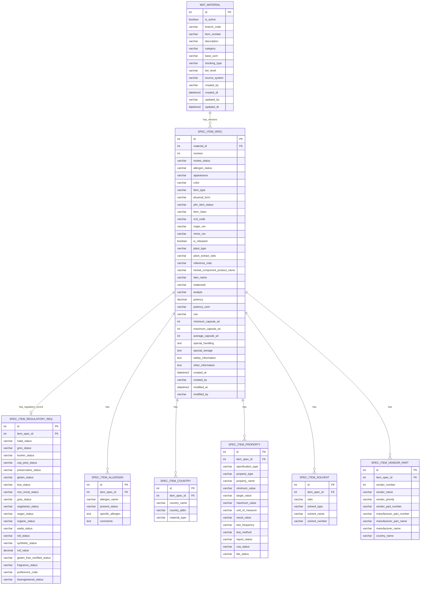
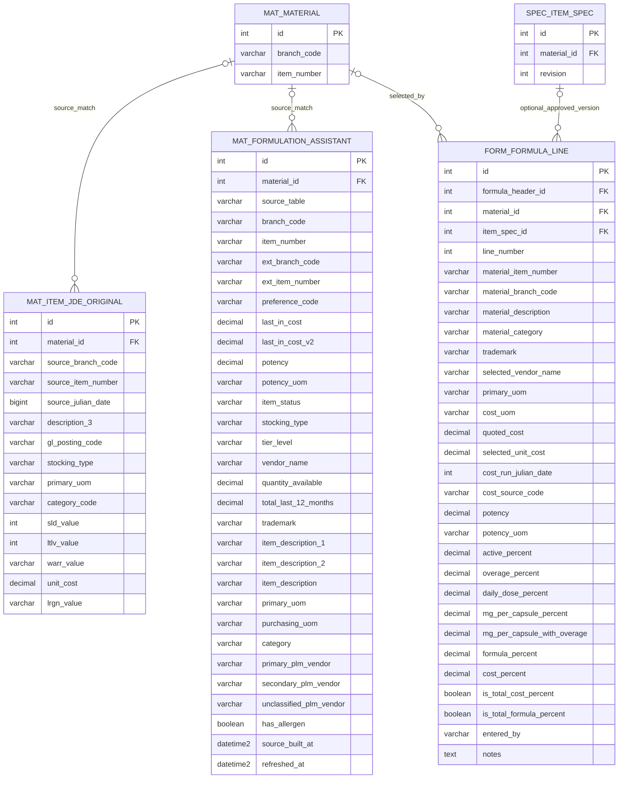

# Proposed material and item specification ERD

The [full proposed ERD](full_proposed_plm_erd.md) shows every
field of each proposed table in one diagram. This document preserves the
legacy-to-target column crosswalk and design notes.

At the November 6, 2026 check, the table creation migration had been applied
in `PLM_DEV`: `mat.material` contained 47,156 branch-scoped identities seeded
from the three assistant snapshots and non-05 Item-only keys, while the
`spec.item_*` targets were still empty. These are historical counts; use the
current refresh scripts and their reconciliation output for live status.
This document maps the `dbo.Item_*` columns and the assistant projection into
the `mat` + `spec` model. The empty legacy `PLM_DEV.dbo.material` was replaced.

## Schema and naming decision

Keep `mat` for branch-scoped material identity and physical JDE and
assistant snapshots. Use `spec` for PLM-owned specifications and their typed
children. Retain recognizable source names for the snapshot tables as
`mat.item_jde_original` and `mat.formulation_assistant`. The `spec.item_*`
names identify editable records without reusing the old `dbo.Item_*` tables:

| Current source | Proposed destination | Treatment |
|---|---|---|
| `dbo.Item_Extension` | `spec.item_spec` | Main PLM-entered specification and source audit fields |
| `dbo.Item_Regulatory_Requirement` | `spec.item_regulatory_req` | Separate branch/item regulatory record |
| `dbo.Item_Allergen` | `spec.item_allergen` | One-to-many child |
| `dbo.Item_Country` | `spec.item_country` | One-to-many child |
| `dbo.Item_Property` | `spec.item_property` | One-to-many child |
| `dbo.Item_Solvent` | `spec.item_solvent` | One-to-many child |
| `dbo.Item_Vendor_Part` | `spec.item_vendor_part` | One-to-many child |
| `dbo.Item_JDE_Original` | `mat.item_jde_original` | Physical dated snapshot of source values, outside editable specs |
| `dbo.Formulation_Assistant`, `dbo.Formulation_Assistant_BP05`, `dbo.Formulation_Assistant_BP15` | `mat.formulation_assistant` | One physical snapshot for all branches; retain source table and duplicate rows |
| Current `dbo.material`, `material_branch`, `material_specification` | `mat.material` and typed `spec` tables | Combine the empty material prototypes by branch/item key |

PLM identifies and describes a material within a branch. The same product at
another branch need not have the same name or PLM identity. Therefore the
proposed `mat.material` has one row per `(branch_code, item_number)` and holds
that branch's description, category, UOM, stocking type, and tier level.
The `is_active` flag supports soft deactivation without removing referenced
formula lines, specifications, or source snapshots.
`mat.material_branch` adds no useful PLM identity and is removed from this
proposal. For example, item `12345` at branches `10` and `BP05` produces two
independent material rows, which may have different descriptions. Do not infer
a cross-branch product relationship from a matching item number. If one is
needed later, model it explicitly with a separate mapping.

JDE may still expose a global item master and a branch table. That source
structure can be flattened into the branch-scoped PLM material row during
migration. If `mat.material` includes finished goods, blends, and packaging as
well as ingredients, `mat.item` may be a more accurate table name; the branch
scope and key would remain the same.

## Canonical tables

These are proposed columns, in snake_case. `id` is the PK of every new table.
The source key is `(branch_code, item_number)` for migration and lookup;
new child relationships use integer FKs. `item_spec.revision` is an explicit
business version, not SQL Server's transaction-time history.

Suggested constraints: `UNIQUE(branch_code, item_number)` on `mat.material`;
`UNIQUE(material_id, revision)` on
`spec.item_spec`; `UNIQUE(item_spec_id)` on `spec.item_regulatory_req`. Do not
add uniqueness to vendor role, allergen name, or
property name until source duplicates and business rules are profiled. Do not
cascade deletion from an approved spec to its historical formula use.
The current `dbo.material.item_number` uniqueness in the ORM must be replaced
when this proposal is implemented.

## Snapshot tables and formula-line link

`item_spec_id` on `form.formula_line` is **proposed**; it is not present today.
The existing `material_id` would point to the branch-scoped `mat.material`
after the migration, using the line's branch and item number to resolve it.
The final line would reference that material and, when relevant, a specific
approved spec revision. The source item number, branch, and selected line values
stay for provenance and formula reproducibility. `mat.item_jde_original` and
`mat.formulation_assistant` remain physical tables. The latter combines three
source assistant tables, retaining `source_table` and every row. Their source
keys are kept even when a `material_id` cannot be resolved. The assistant can
contain multiple rows per branch/item; do not collapse them or enforce a unique
branch/item constraint. BP15 lacks `item_description` in its current source,
so that target column is nullable.
Replacing rows on each refresh retains only the latest snapshot. If historical
assistant loads need to be queryable, add a `snapshot_run_id` and append each
load instead.

## Complete legacy column crosswalk

The following tables account for 116 columns in the eight current `Item_*`
tables plus the 26-column assistant shape, 142 source columns in total.
Repeated legacy `(branch, item)`
columns become the parent FK in typed child tables; they are still available
through joins. A few source codes still need business-definition confirmation.
Where the crosswalk maps a source identity column to `id`, preserving the source
ID is an option; otherwise record it in migration staging for traceability.

### `dbo.Item_Extension` → `mat.material` + `spec.item_spec`

| Current column | Proposed column |
|---|---|
| `EXMCU` | `mat.material.branch_code` (resolved FK) |
| `EXLITM` | `mat.material.item_number` (resolved FK) |
| `EXALRG` | `spec.item_spec.allergen_status` (preserve source values, including allergen names) |
| `EXAPPE` | `spec.item_spec.appearance` |
| `EXCLOR` | `spec.item_spec.color` |
| `EXITY` | `spec.item_spec.item_type` |
| `EXPSYF` | `spec.item_spec.physical_form` |
| `EXSTA` | `spec.item_spec.plm_item_status` |
| `EXCLAS` | `spec.item_spec.item_class` |
| `EXCRON` | `spec.item_spec.created_at` |
| `EXCRBY` | `spec.item_spec.created_by` |
| `EXMDON` | `spec.item_spec.modified_at` |
| `EXMDBY` | `spec.item_spec.modified_by` |
| `EXICNT` | `spec.item_spec.icnt_code` |
| `EXMAJR` | `spec.item_spec.major_rev` |
| `EXMNOR` | `spec.item_spec.minor_rev` |
| `EXRLSD` | `spec.item_spec.is_released` |
| `EXPLPT` | `spec.item_spec.plant_type` |
| `EXPEXR` | `spec.item_spec.plant_extract_ratio` |
| `EXREF` | `spec.item_spec.reference_note` |
| `EXHCPN` | `spec.item_spec.herbal_component_product_name ` |
| `EXLATN` | `spec.item_spec.latin_name` |
| `EXTMRK` | `spec.item_spec.trademark` |
| `EXNLYT` | `spec.item_spec.analyte` |
| `EXPTNC` | `spec.item_spec.potency` |
| `EXPTUM` | `spec.item_spec.potency_uom` |
| `EXCAS` | `spec.item_spec.cas` |
| `EXMNCP` | `spec.item_spec.minimum_capsule_wt` |
| `EXMXCP` | `spec.item_spec.maximum_capsule_wt` |
| `EXAVCP` | `spec.item_spec.average_capsule_wt` |
| `EXSPLH` | `spec.item_spec.special_handling` |
| `EXSPLS` | `spec.item_spec.special_storage` |
| `EXSAFT` | `spec.item_spec.safety_information` |
| `EXUTHR` | `spec.item_spec.other_information` |

### `dbo.Item_Regulatory_Requirement` → `spec.item_regulatory_req`

Its composite source PK `(RRMCU, RRLITM)` resolves to one branch-scoped material
and then an `item_spec` revision. If there is no extension row, create a minimal
spec revision for the regulatory record once its material is resolved.
Linking regulatory data to the revision preserves the full approved spec state.

| Current column | Proposed column |
|---|---|
| `RRMCU` | `mat.material.branch_code` (resolved FK) |
| `RRLITM` | `mat.material.item_number` (resolved FK) |
| `RRGMO` | `gmo_status` |
| `RRHALA` | `halal_status` |
| `RRKOSH` | `kosher_status` |
| `RRUSP` | `usp_pest_status` |
| `RRPRSV` | `preservative_status` |
| `RRGLTN` | `gluten_status` |
| `RRBSE` | `bse_status` |
| `RRNNET` | `non_novel_status` |
| `RRGRAS` | `gras_status` |
| `RRVGTR` | `vegetarian_status` |
| `RRVEGN` | `vegan_status` |
| `RROGNC` | `organic_status` |
| `RRWADA` | `wada_status` |
| `RRNDI` | `ndi_status` |
| `RRSYNT` | `synthetic_status` |
| `RRNSF` | `nsf_value` |
| `RRGFCO` | `gluten_free_certified_status` |
| `RRFRIG` | `fragrance_status` |
| `RRPREF` | `preference_code` |
| `RRBIO` | `bioengineered_status` |

### `dbo.Item_Allergen` → `spec.item_allergen`

| Current column | Proposed column |
|---|---|
| `ALIDNT` | `id` |
| `ALMCU` | parent spec's `material.branch_code` |
| `ALLITM` | parent spec's `material.item_number` |
| `ALALRG` | `allergen_name` |
| `ALPSNT` | `present_status` |
| `ALSALL` | `specific_allergen` |
| `ALCMTS` | `comments` |

### `dbo.Item_Country` → `spec.item_country`

| Current column | Proposed column |
|---|---|
| `CNIDNT` | `id` |
| `CNMCU` | parent spec's `material.branch_code` |
| `CNLITM` | parent spec's `material.item_number` |
| `CNCTR` | `country_name` |
| `CNCTRT` | `country_abbv` |
| `CNCOTP` | `material_type` |

### `dbo.Item_Property` → `spec.item_property`

| Current column | Proposed column |
|---|---|
| `IPIDNT` | `id` |
| `IPMCU` | parent spec's `material.branch_code` |
| `IPLITM` | parent spec's `material.item_number` |
| `IPSPCT` | `specification_type` |
| `IPPTTY` | `property_type` |
| `IPPRPT` | `property_name` |
| `IPPPMN` | `minimum_value` |
| `IPPTRG` | `target_value` |
| `IPPPMX` | `maximum_value` |
| `IPUM` | `unit_of_measure` |
| `IPRZLT` | `result_value` |
| `IPFREQ` | `test_frequency` |
| `IPMEHD` | `test_method` |
| `IPSRPT` | `report_status` |
| `IPSCOA` | `coa_status` |
| `IPSLAB` | `lab_status` |

### `dbo.Item_Solvent` → `spec.item_solvent`

| Current column | Proposed column |
|---|---|
| `ISIDNT` | `id` |
| `ISMCU` | parent spec's `material.branch_code` |
| `ISLITM` | parent spec's `material.item_number` |
| `ISRTIO` | `ratio` |
| `ISSLVT` | `solvent_type` |
| `ISSNME` | `solvent_name` |
| `ISSLVN` | `solvent_number` |

### `dbo.Item_Vendor_Part` → `spec.item_vendor_part`

| Current column | Proposed column |
|---|---|
| `IVIDNT` | `id` |
| `IVMCU` | parent spec's `material.branch_code` |
| `IVLITM` | parent spec's `material.item_number` |
| `IVVEND` | `vendor_number` |
| `IVVNDN` | `vendor_name` |
| `IVPRNC` | `vendor_priority` |
| `IVVPNO` | `vendor_part_number` |
| `IVMPNO` | `manufacturer_part_number` |
| `IVMPNM` | `manufacturer_part_name` |
| `IVMFGN` | `manufacturer_name` |
| `IVCTR` | `country_name` |

### `dbo.Item_JDE_Original` → `mat.item_jde_original`

The source PK is `(JDMCU, JDLITM, JDTRDJ)`. Keep the raw tuple to preserve
unmatched records and add a nullable `material_id` until coverage against the
branch-scoped material keys has been verified.

| Current column | Proposed column |
|---|---|
| `JDMCU` | `source_branch_code` |
| `JDLITM` | `source_item_number` |
| `JDTRDJ` | `source_julian_date` |
| `JDDSC3` | `description_3` |
| `JDGLPT` | `gl_posting_code` |
| `JDSTKT` | `stocking_type` |
| `JDUOM1` | `primary_uom` |
| `JDPRP2` | `category_code` |
| `JDSLD` | `sld_value` |
| `JDLTLV` | `ltlv_value` |
| `JDWARR` | `warr_value` |
| `JDUNCS` | `unit_cost` |
| `JDLRGN` | `lrgn_value` |

### `dbo.Formulation_Assistant*` → `mat.formulation_assistant`

`Formulation_Assistant_BP05` has the same 26-column shape. The current BP15
table has the first 25 columns and no `Item_Description`. The three source
tables load into one physical `mat.formulation_assistant` table, retaining
`source_table` and every source row. The mapping below applies to all three;
`item_description` is `NULL` for BP15. A new `refreshed_at` records each load.

| Current column | Proposed column |
|---|---|
| `IB_item_number` | `item_number` |
| `EX_item_number` | `ext_item_number` |
| `prefer` | `preference_code` |
| `IB_branch` | `branch_code` |
| `EX_branch` | `ext_branch_code` |
| `last_in_cost` | `last_in_cost` |
| `potency` | `potency` |
| `potency_UOM` | `potency_uom` |
| `item_status` | `item_status` |
| `stocking_type` | `stocking_type` |
| `tier_level` | `tier_level` |
| `vendor_name` | `vendor_name` |
| `quantity_available` | `quantity_available` |
| `total_last_12_months` | `total_last_12_months` |
| `trademark` | `trademark` |
| `item_description_1` | `item_description_1` |
| `item_description_2` | `item_description_2` |
| `primary_UOM` | `primary_uom` |
| `purch_UOM` | `purchasing_uom` |
| `last_in_cost_v2` | `last_in_cost_v2` |
| `Category` | `category` |
| `PLM_Vendor1` | `primary_plm_vendor` |
| `PLM_Vendor2` | `secondary_plm_vendor` |
| `PLM_Vendor_UNK` | `unclassified_plm_vendor` |
| `Allergen` | `has_allergen` |
| `Item_Description` | `item_description` (`NULL` for current BP15 rows) |

The assistant's item descriptions and vendor slots are deliberately retained
in this snapshot for UI compatibility. They do not become additional
canonical specification fields. `Item_Description` and
`item_description_1` are generated by the same expression in the branch-10
procedure, so the new projection could expose two aliases of one expression
instead of storing the value twice in a downstream projection.

## Existing PLM_DEV target columns

These three `dbo` tables are currently empty. This section accounts for their
current ORM columns and shows where they would live under the proposed design.
The current surrogate IDs need not be preserved because there are no rows.

| Current table | Current columns | Proposed treatment |
|---|---|---|
| `dbo.material` | `id`, `item_number`, `description`, `category`, `base_uom` | `mat.material`, with a new branch code on each row; current IDs need not be retained |
| `dbo.material` | `cas_number`, `latin_name`, `trademark` | Move to `spec.item_spec`; the legacy source is branch-scoped |
| `dbo.material` | `created_by`, `created_dt`, `updated_by`, `updated_dt` | `mat.material` audit columns |
| `dbo.material_branch` | `id`, `material_id`, `branch_code`, `stocking_type`, `tier_level` | Flatten branch code, stocking type, and tier level into `mat.material`; current branch ID and FK are migration inputs only |
| `dbo.material_branch` | `item_status` | `spec.item_spec.plm_item_status` if PLM-entered; JDE status stays in `mat.formulation_assistant` |
| `dbo.material_branch` | `vendor_name`, `vendor_number` | `spec.item_vendor_part` for a PLM-selected vendor, or the relevant assistant snapshot for the JDE default; ownership must be chosen |
| `dbo.material_branch` | `unit_cost`, `quantity_available` | The relevant assistant snapshot; these are changing lookup values |
| `dbo.material_branch` | `created_by`, `created_dt`, `updated_by`, `updated_dt` | Use branch audit values for the branch-scoped `mat.material` row; preserve any different source audit values in staging if needed |
| `dbo.material_specification` | `id`, `material_id`, `branch_code` | Replace with `spec.item_spec` and typed child IDs/FKs |
| `dbo.material_specification` | `kind`, `name`, `value`, `status`, `notes` | Replace with typed detail columns; retain a generic property row only for genuinely unstructured attributes |
| `dbo.material_specification` | `created_by`, `created_dt`, `updated_by`, `updated_dt` | Audit columns on the applicable typed `spec` table |

The existing `form.formula_line` columns are listed in full in the second ERD.
Its proposed `item_spec_id` is additive; every other listed line column already
exists. The current `material_id` FK points to `dbo.material`; its proposed
target is the branch-scoped `mat.material`.

## Migration and constraint gates

1. Establish one material record for each source `(branch, item)` key, using
JDE item master/branch as the primary source and preserving
PLM-only keys for review. A child row without `Item_Extension` is not
automatically an orphan: production contains 210 regulatory branch/item
keys and other detail keys without an extension row.
Before switching `form.formula_line.material_id` to `mat.material.id`, resolve
each line using both its branch code and item number.
2. Stage and crosswalk legacy rows, including the source identity IDs and raw
branch/item/date tuple for `Item_JDE_Original`. Only then set new child FKs
`NOT NULL`. Keep unresolved records in a review/staging area instead of
silently dropping them.
3. Keep assistant duplicates in the snapshot. Branch 10 currently has 502
duplicate branch/item keys and a maximum of 12 rows for one key. A separate
consumer that needs one result per key must choose a documented row-selection
rule.
4. Decide whether an approved formula needs the *full* item specification as
approved. If yes, make `spec.item_spec` revisions immutable after approval
and link `form.formula_line.item_spec_id` to the chosen revision. A date-stamped
audit history alone does not identify the approved business version.
5. Use `ON DELETE RESTRICT`/`NO ACTION` for referenced approved specs and
formula lines. Avoid cascades that erase historical formula evidence.

The names and types here are a reviewable design. Column widths, enum/code
definitions, the five opaque extension codes, and the JDE-original field
meanings need source-system confirmation before writing migrations.
